# printlog

**[English](#english) · [Deutsch](#deutsch)**

---

<a id="english"></a>

## English

**A print history for your Bambu Lab printers, with evaluation and real costs, fed by Home Assistant.**

printlog is a small self-hosted web app that keeps a complete log of every print automatically: when it ran, on which
printer, what it printed, how much filament from which AMS slot, how much electricity it used and how it ended. On top of
that history you get statistics, a calendar, your own photos and notes, and an exact cost calculation per print, with
selling prices, customers and payments if you need them. It runs as a single Docker container next to Home Assistant
and never talks to the Bambu cloud.

The interface is available in **English and German** (Settings → View → Language, or automatically from your browser),
in a **light and a dark** colour scheme (Settings → View → Colour scheme, or automatically like the device).

<picture><source media="(prefers-color-scheme: dark)" srcset="docs/screenshots/en-dark/prints.png">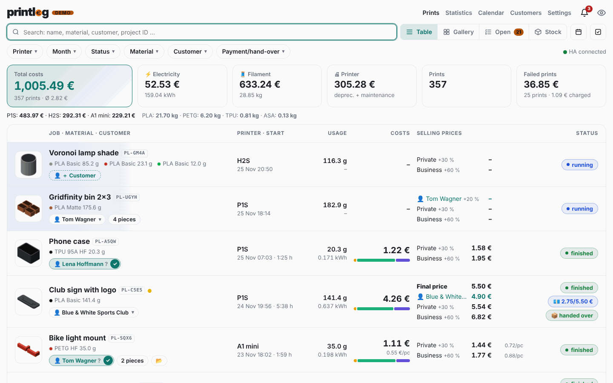</picture>

> **About this project:** printlog is built for my own setup (Bambu Lab printers, Home Assistant, a few smart plugs)
> and will stay tailored to it. You are welcome to use it as it is. If you want to change it substantially, please
> **fork it** and make it your own; larger feature pull requests will most likely not be merged. Bug reports and small
> fixes are welcome.

### Contents

[Features](#features) · [Screenshots](#screenshots) · [How it works](#how-it-works) · [Requirements](#requirements) ·
[Installation](#installation) · [Configuration](#configuration) · [Updating](#updating) · [The printlog event](#the-printlog-event) ·
[Other printers](#other-printers) · [Troubleshooting](#troubleshooting) · [API](#api)

### Features

**Print history**

- **Automatic log** of every print: start, end, duration, status (finished / failed / incomplete), task name, printer,
  cover image, filament per AMS slot with colour, and kWh.
- **Find anything again** – live search over name, material, customer, notes and project links; filters for printer,
  month, status, material, customer and payment as compact chips (an active filter shows its value and an ✕ to remove it);
  table or gallery, optionally grouped by day.
- **Open items** – the **Open** view next to Table and Gallery lists every print that is not fully paid or handed over yet,
  grouped by customer with the open amount and pieces per customer and buttons to record a payment or hand-over right there.
  Customers with **No billing** and failed prints that are not charged are left out; gifted prints only show up until they are handed over.
- **Assign customers in two taps** – a print without a customer shows a **👤 ＋ Customer** chip right in the list (also on
  the phone and on the print page). Tap it, pick a customer, done: no Edit tab, no Save button, and an *Undo* for ten seconds.
  The picker has a search, the three most recent customers and a suggestion: if you printed the same model for someone
  before, the chip already reads *Tom ? ✓* and the ✓ alone assigns it. For many prints at once use *Select → 👤 Assign customer*
  (e.g. together with the filter *Customer: none*). **＋ New customer** creates one with just a name. On a project the customer
  applies to the whole project.
- **Your own details** – photos (camera upload, auto-resized), notes, filament notes (e.g. the exact colour name),
  MakerWorld / Printables links with their title, a local folder path, and a short project ID per print (e.g. `PL-7K3Q`).
- **Failed prints** – cancelled prints count as failed automatically, and you can mark any print yourself, e.g. when it
  finished but the settings were off. Pick a cause (settings, material, adhesion, printer fault, customer changed their mind,
  other) and decide what the customer pays: nothing, a share (in % or as an amount) or the full price. A charged failed
  print then shows under **Open**, on the receipt and in the PDF like any other print. Notes and photos document what
  happened, and the reprint can be linked. Statistics show failed prints by cause, what was charged and what you carry yourself.
- **Projects** – things made of many parts are often printed on several printers at once. Select the prints
  (*Select → 📦 Make project*), give the project a name, a customer and the number of finished items, and the list shows it as
  one row with the summed costs and a ▾ to fold out the single prints. The project gets its own ID, its own page with all prints,
  a timeline per printer and photos, and it is billed as a whole: price, payments, hand-overs, receipt and PDF run through the
  project. Failed prints in it that are not charged do not count towards the price. The single prints keep their details and
  can be removed from the project again; *Ungroup* turns everything back into single prints. Statistics keep counting prints.
- **Split pieces between customers and stock** – printed 10 clips, 2 go to Tom, 4 to Anna and 4 stay on the shelf?
  **✂ Split** on the print page shares the quantity between customers; whatever is left over is your **stock**. The list keeps
  one row with chips like *Tom 2 · Anna 4 · 📦 Stock 4*, and each customer gets their own share with its own price
  (cost per piece + their margin, or a final price), payments, hand-overs and receipt, so **Open** shows exactly what each one
  still owes. The **Stock** view next to *Open* lists everything on the shelf with its value at cost; **Give …** hands pieces to
  a customer later (the price suggestion is configurable under *Settings → Margins*) or writes them off without a customer
  (used myself, broken, lost). Projects are split in **sets** (the project's quantity), and single parts of a set can be given
  away on their own, e.g. just one head of a figure kit.
- **Trash bin** with restore; deleted prints are removed for good only after a configurable number of days.
- **Robust** – after a restart or a lost connection, printlog replays missed prints from Home Assistant's history (up to 7 days).

**Evaluation**

- **Statistics** by day, week or month: print hours per printer, cost split, filament by material, success rate,
  a table per printer and a yearly heat map of print hours.
- **Calendar** with the prints, hours, costs and thumbnails of each day.
- **Data & backup** in the settings: full backup as one **ZIP** (database, photos, logo, all settings) to download and restore,
  **CSV export** (Excel-friendly), a scheduled **backup** to a mounted folder and a guarded **reset**.

**Costs and customers**

- **Real costs per print**
  - *Electricity* from a smart plug's kWh meter (start → end of cool-down), or an estimate from a fixed wattage if you have no plug.
  - *Filament* per AMS slot (grams × €/kg), priced by type (PLA, PETG …) or by exact product (e.g. "Bambu PLA Matte").
  - *Printer* depreciation, maintenance per year and wear per hour.
- **Selling prices** – two named margins, an optional margin per customer and a fixed final price per print.
- **Customers** – partial payments and partial hand-overs, gifts, open amounts per customer. Tick **No billing** for
  a customer you only use for your own prints (e.g. models you upload): costs and statistics still count, but there are
  never open amounts, unpaid or not-handed-over badges, no "Billing" tab and no payment status on receipt or PDF.
  The customer list stays compact: **Edit** opens the fields right in the row, **+ New customer** sits top right.
- **Sharing** – a receipt-style PNG for the customer (WhatsApp etc.), an internal version with the full calculation,
  and an A4 PDF cost sheet, in the language of the interface.
- **Discreet mode** – one click blurs all internal figures when a customer is watching.
- **Demo mode** – *Settings → View → Open demo* shows the whole app with a year of made-up prints (three Bambu printers,
  customers with partial payments and open hand-overs, gifts, failed prints, running prints, photos). Handy for screenshots
  and for trying printlog out. The demo has its own database; your real prints, Home Assistant and the backup are never touched.

### Screenshots

| | |
|---|---|
| <a href="docs/screenshots/en/prints-filtered.png"><picture><source media="(prefers-color-scheme: dark)" srcset="docs/screenshots/en-dark/prints-filtered.png">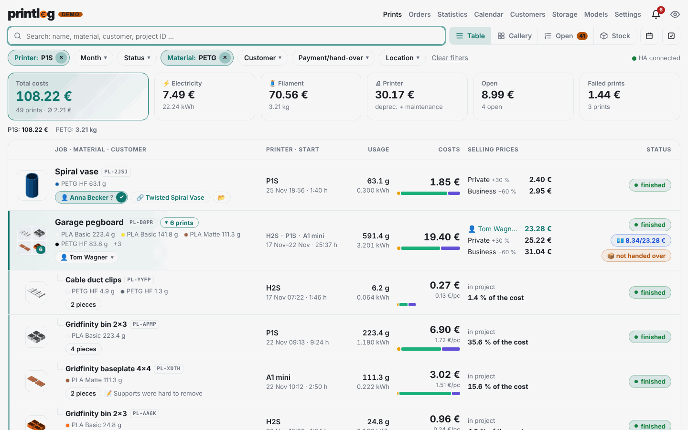</picture></a><br>**Search and filter chips** | <a href="docs/screenshots/en/gallery.png"><picture><source media="(prefers-color-scheme: dark)" srcset="docs/screenshots/en-dark/gallery.png">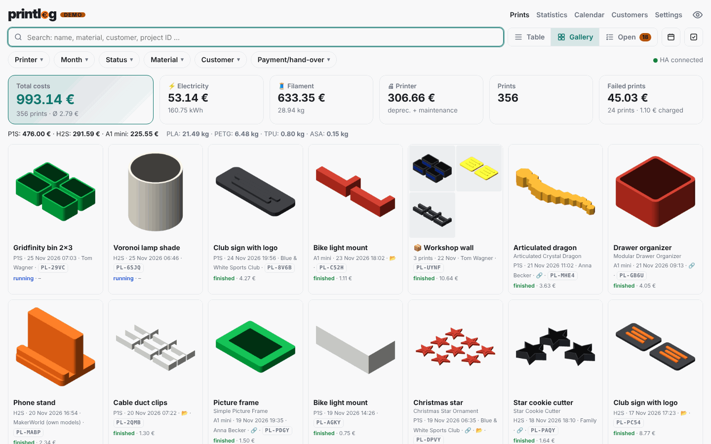</picture></a><br>**Gallery with cover images** |
| <a href="docs/screenshots/en/open-items.png"><picture><source media="(prefers-color-scheme: dark)" srcset="docs/screenshots/en-dark/open-items.png">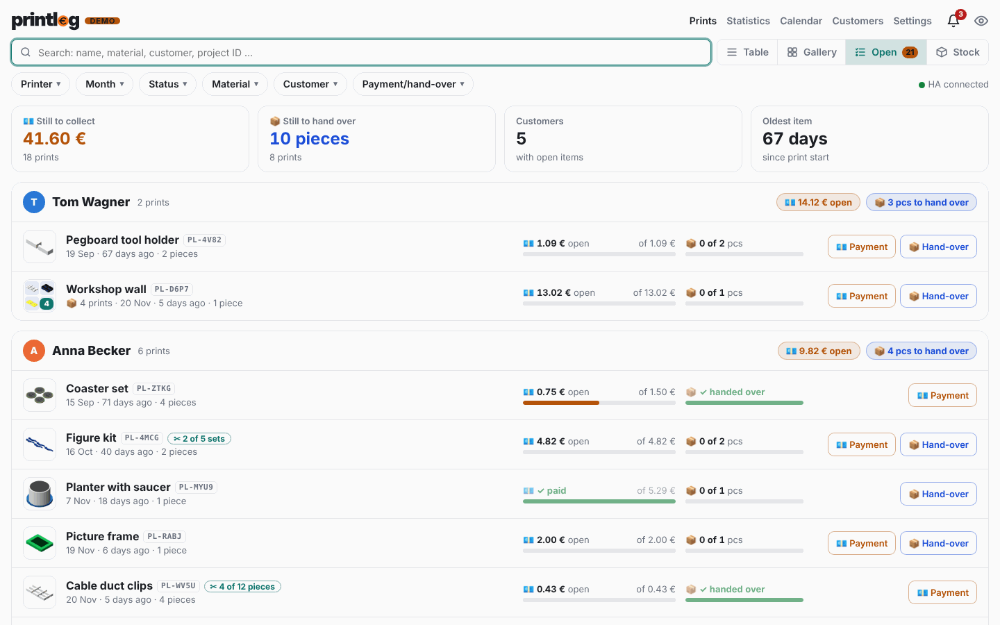</picture></a><br>**Open: still to be paid or handed over** | <a href="docs/screenshots/en/print-detail.png"><picture><source media="(prefers-color-scheme: dark)" srcset="docs/screenshots/en-dark/print-detail.png">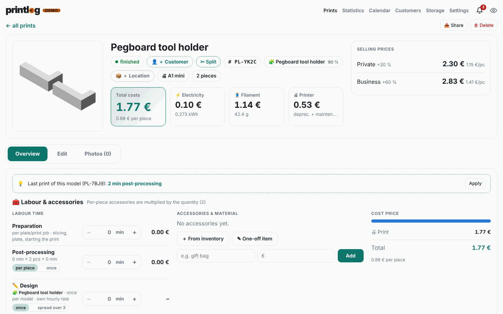</picture></a><br>**Print detail with costs and selling prices** |
| <a href="docs/screenshots/en/print-billing.png"><picture><source media="(prefers-color-scheme: dark)" srcset="docs/screenshots/en-dark/print-billing.png">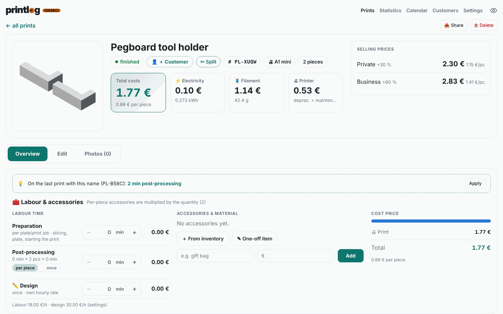</picture></a><br>**Billing: final price, payments, hand-overs** | <a href="docs/screenshots/en/statistics.png"><picture><source media="(prefers-color-scheme: dark)" srcset="docs/screenshots/en-dark/statistics.png">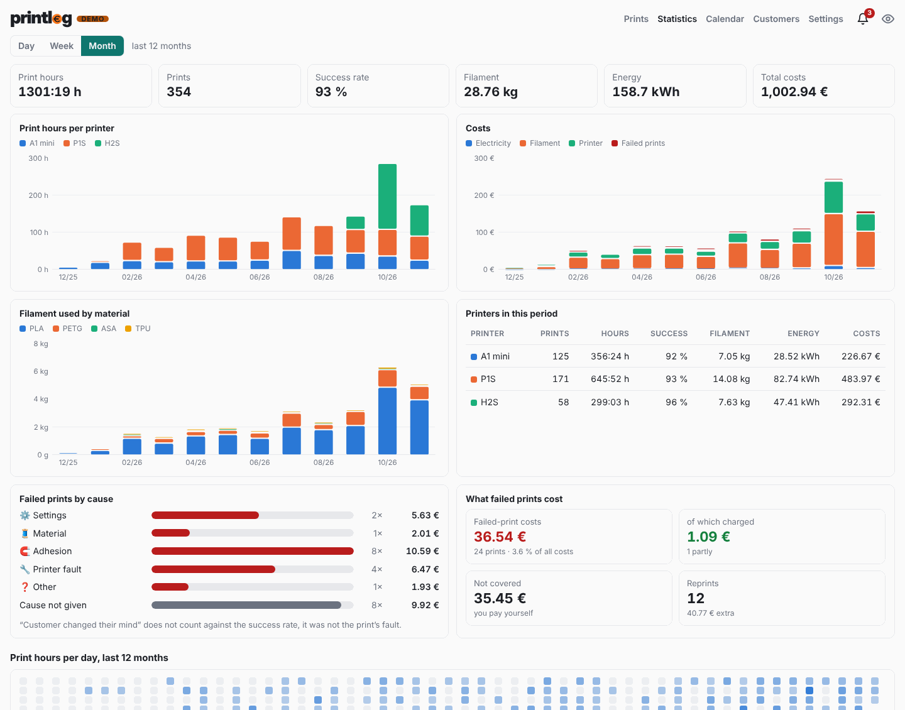</picture></a><br>**Statistics** |
| <a href="docs/screenshots/en/calendar.png"><picture><source media="(prefers-color-scheme: dark)" srcset="docs/screenshots/en-dark/calendar.png">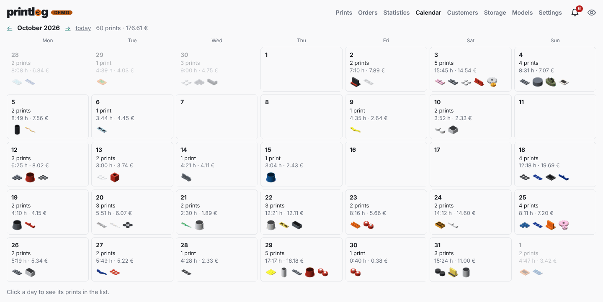</picture></a><br>**Calendar** | <a href="docs/screenshots/en/customers.png"><picture><source media="(prefers-color-scheme: dark)" srcset="docs/screenshots/en-dark/customers.png">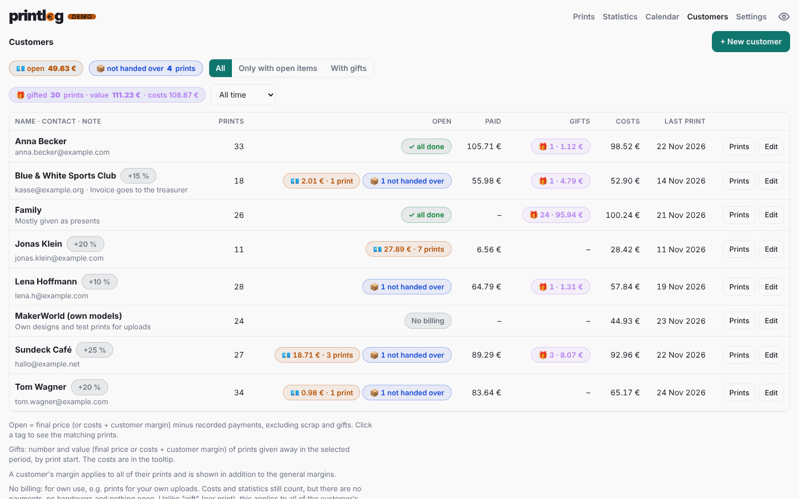</picture></a><br>**Customers** |
| <a href="docs/screenshots/en/failed-print.png"><picture><source media="(prefers-color-scheme: dark)" srcset="docs/screenshots/en-dark/failed-print.png">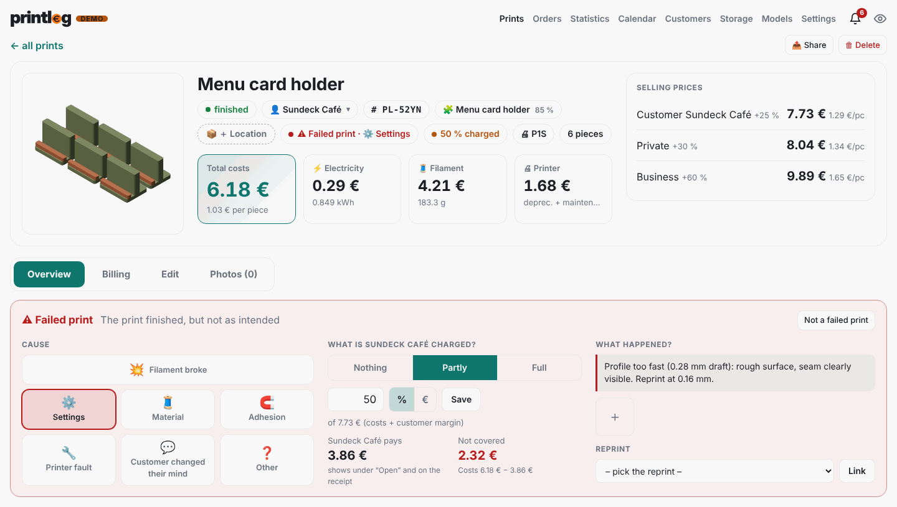</picture></a><br>**Failed print: cause, charge and reprint** | <a href="docs/screenshots/en/failed-print-stats.png"><picture><source media="(prefers-color-scheme: dark)" srcset="docs/screenshots/en-dark/failed-print-stats.png">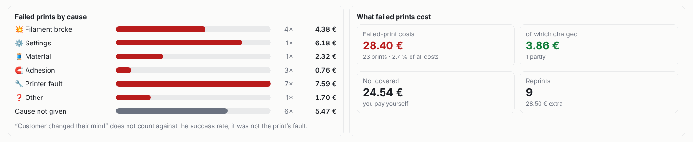</picture></a><br>**Failed prints by cause and what they cost** |
| <a href="docs/screenshots/en/project-list.png"><picture><source media="(prefers-color-scheme: dark)" srcset="docs/screenshots/en-dark/project-list.png">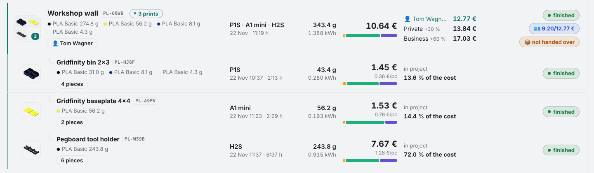</picture></a><br>**Project: one row, prints folded out** | <a href="docs/screenshots/en/project-detail.png"><picture><source media="(prefers-color-scheme: dark)" srcset="docs/screenshots/en-dark/project-detail.png"></picture></a><br>**Project page with prints and timeline** |
| <a href="docs/screenshots/en/assign-customer.png"><picture><source media="(prefers-color-scheme: dark)" srcset="docs/screenshots/en-dark/assign-customer.png">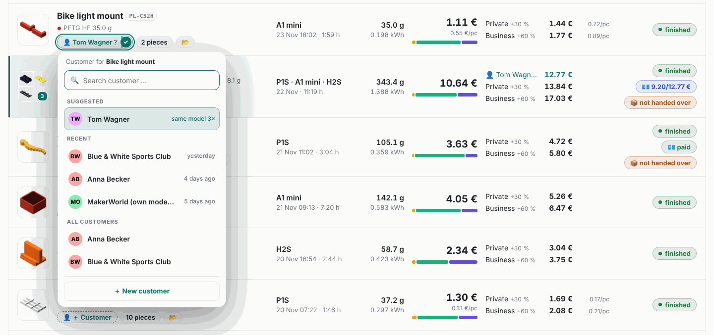</picture></a><br>**Assign a customer: chip in the list with a suggestion** | <a href="docs/screenshots/en/split-list.png"><picture><source media="(prefers-color-scheme: dark)" srcset="docs/screenshots/en-dark/split-list.png">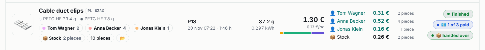</picture></a><br>**Split print: one row, one chip per customer and stock** |
| <a href="docs/screenshots/en/split-detail.png"><picture><source media="(prefers-color-scheme: dark)" srcset="docs/screenshots/en-dark/split-detail.png">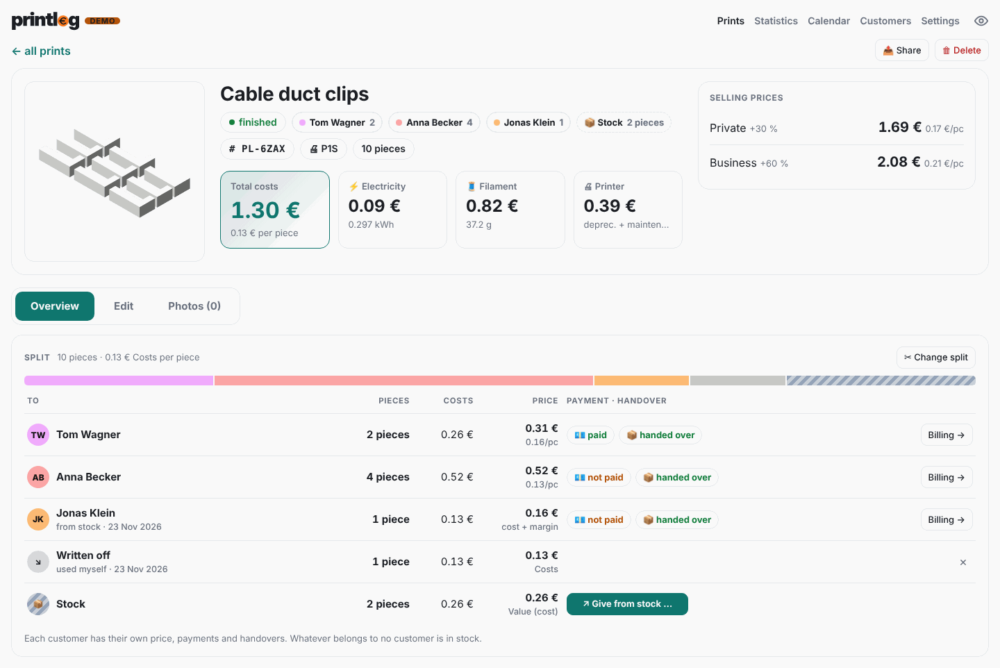</picture></a><br>**Split: each customer with price, payment and hand-over, rest in stock** | <a href="docs/screenshots/en/split-dialog.png"><picture><source media="(prefers-color-scheme: dark)" srcset="docs/screenshots/en-dark/split-dialog.png">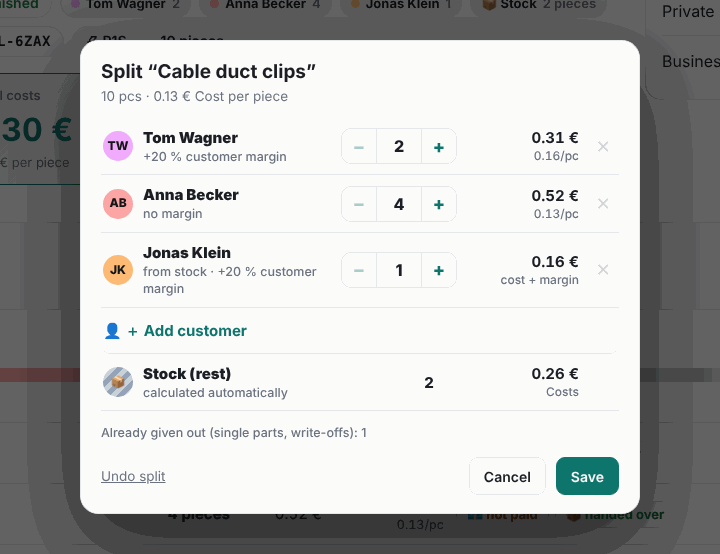</picture></a><br>**Split window: pieces per customer, stock is calculated** |
| <a href="docs/screenshots/en/stock.png"><picture><source media="(prefers-color-scheme: dark)" srcset="docs/screenshots/en-dark/stock.png">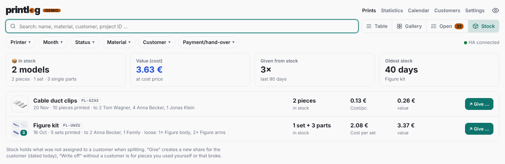</picture></a><br>**Stock: what is left on the shelf and its value** | |

| Phone: prints | Phone: print detail | Phone: open items | Phone: stock |
|---|---|---|---|
| <a href="docs/screenshots/en/phone-list.png"><picture><source media="(prefers-color-scheme: dark)" srcset="docs/screenshots/en-dark/phone-list.png">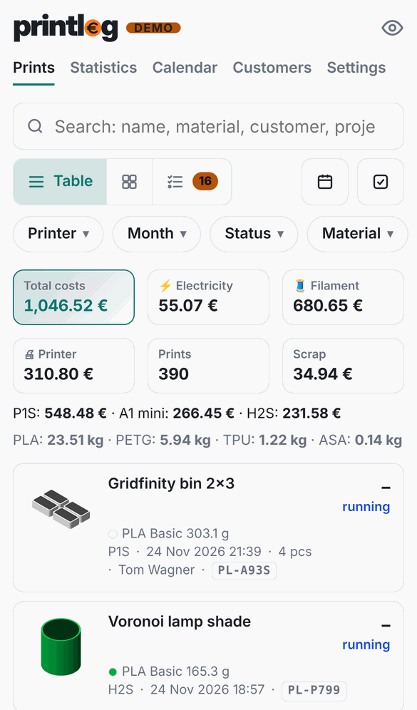</picture></a> | <a href="docs/screenshots/en/phone-detail.png"><picture><source media="(prefers-color-scheme: dark)" srcset="docs/screenshots/en-dark/phone-detail.png">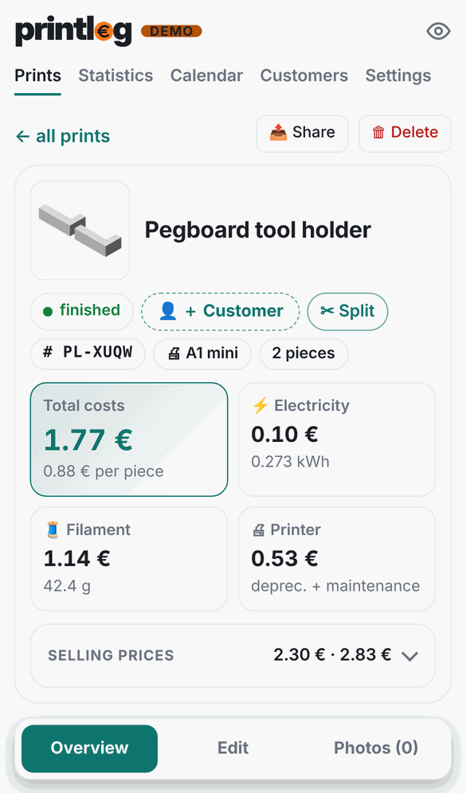</picture></a> | <a href="docs/screenshots/en/phone-open.png"><picture><source media="(prefers-color-scheme: dark)" srcset="docs/screenshots/en-dark/phone-open.png">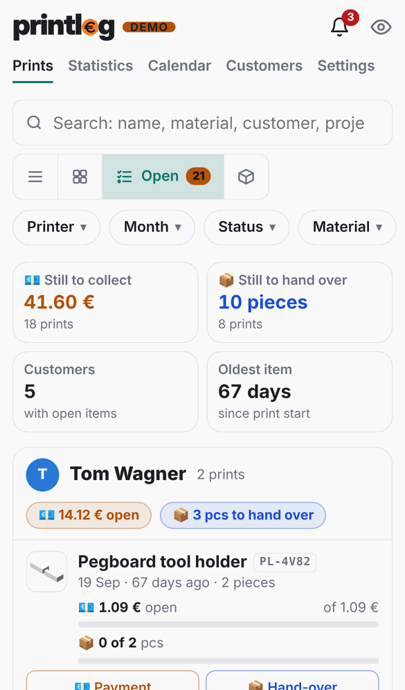</picture></a> | <a href="docs/screenshots/en/phone-stock.png"><picture><source media="(prefers-color-scheme: dark)" srcset="docs/screenshots/en-dark/phone-stock.png">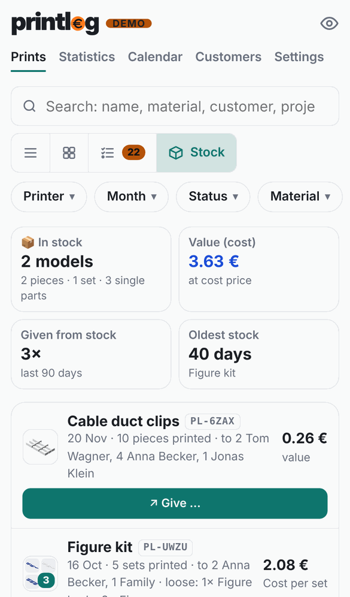</picture></a> |

| Receipt for the customer | Internal receipt with calculation | PDF cost sheet |
|---|---|---|
| <a href="docs/screenshots/en/receipt-customer.png">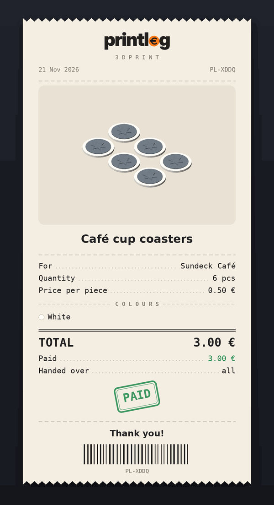</a> | <a href="docs/screenshots/en/receipt-internal.png">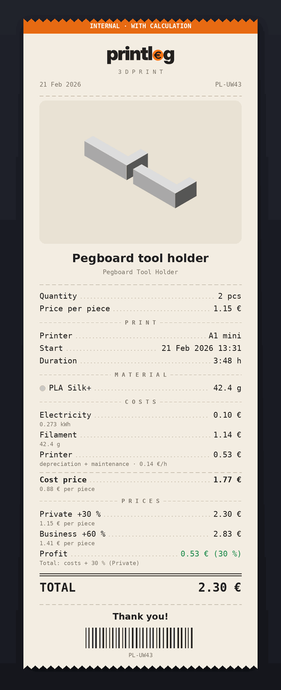</a> | <a href="docs/screenshots/en/cost-sheet.png">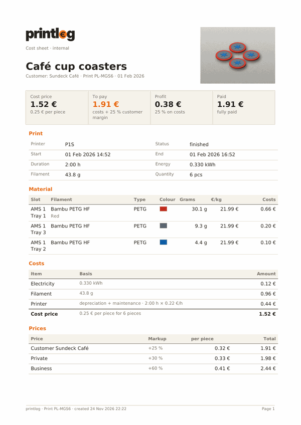</a> |

*All screenshots show made-up sample data from the built-in demo mode (see [Features](#features)). Light or dark images follow your GitHub theme. Click an image to enlarge it. To redo them, see [`docs/screenshots/capture.js`](docs/screenshots/capture.js).*

### How it works

```
 Bambu printer ──► Home Assistant ──(event "printlog")──► printlog container ──► SQLite + images
                    │  Bambu Lab integration                 │  web UI on port 8095
                    │  smart plug (optional)                 │  reads states/history/images via HA API
                    └─ one automation per printer (blueprint)
```

1. The **Bambu Lab integration** in Home Assistant exposes print status, task name, weight per AMS slot and the cover image.
2. An **automation per printer** (from the included blueprint) fires a `printlog` event at print start, at print end,
   and once more after the cool-down phase with the final meter reading.
3. The **printlog container** listens on Home Assistant's WebSocket API, stores each print and calculates its costs.

Home Assistant stays lean: it only sends events. All logic and evaluation happen in the container.

### Requirements

| What | Notes |
|---|---|
| Home Assistant | Recent version (the blueprint needs 2024.10 or newer). |
| [Bambu Lab integration](https://github.com/greghesp/ha-bambulab) | Installed via HACS. Provides the `…_print_status`, `…_print_weight`, `…_task_name`, AMS tray sensors and `image.…_cover_image`. |
| Smart plug per printer *(optional)* | Needs an **energy** sensor (kWh, total) and ideally a **power** sensor (W). Shelly, Tasmota, Zigbee plugs etc. all work. Without a plug, set a fixed wattage per printer in printlog. |
| Electricity price | An entity holding €/kWh, e.g. a number helper. |
| Docker | Docker Compose or Portainer on any host that can reach Home Assistant. |

Other printer brands are not supported out of the box (see [Other printers](#other-printers)).

### Installation

#### 1. Prepare Home Assistant

1. Install the **Bambu Lab** integration via HACS and add your printers.
2. *(Optional)* Add a smart plug for each printer.
3. Create the electricity price helper: *Settings → Devices & services → Helpers → Create helper → Number*,
   unit €/kWh, step 0.001, and set your price. printlog reads `input_number.strompreis` by default; if you name it
   differently (e.g. `input_number.electricity_price`), set `PRICE_ENTITY` accordingly or pick it in the blueprint.
4. Create a **long-lived access token**: click your user profile → *Security* → *Long-lived access tokens* → *Create token*.
   Name it `printlog` and copy it.

#### 2. Run the container

**Docker Compose**

```bash
git clone https://github.com/relax81/printlog.git
cd printlog
cp .env.example .env      # set HA_URL and HA_TOKEN
docker compose up -d --build
```

Open `http://<docker-host>:8095`. `http://<docker-host>:8095/health` returns `200` once printlog is connected to Home Assistant.

**Portainer (Git stack)**

*Stacks → Add stack → Repository*: repository URL of this repo, branch `main`, compose path `docker-compose.yml`.
Under *Environment variables* add at least `HA_URL` and `HA_TOKEN`. Deploy. To update later: *Pull and redeploy*
(or enable GitOps polling).

#### 3. Install the blueprint

The blueprint comes in two languages with identical function; pick one:

- English: [`blueprints/automation/printlog/printlog_printer.yaml`](blueprints/automation/printlog/printlog_printer.yaml)
- German: [`blueprints/automation/printlog/printlog_drucker.yaml`](blueprints/automation/printlog/printlog_drucker.yaml)

Import it under *Settings → Automations & scenes → Blueprints → Import blueprint* with the file's GitHub URL, or copy
the file to `/config/blueprints/automation/printlog/` on your Home Assistant and reload automations.

#### 4. Create one automation per printer

*Settings → Automations & scenes → Blueprints → "printlog: record prints (Bambu Lab)" → Create automation*, then fill in:

| Input | What to pick |
|---|---|
| **Short name** | Short unique key, lowercase, e.g. `x1c`. Prints are stored under this key, so don't change it later. |
| **Print status** | The printer's `sensor.…_print_status`. All other printer entities are found by the same name prefix. |
| **AMS units** | For each AMS, its *tray 1* sensor (`sensor.…_tray_1`), in order AMS 1, AMS 2 … Leave empty without AMS. |
| **External spool** | `sensor.…_external_spool` *(optional)* |
| **Energy meter** | The plug's kWh sensor *(optional)* |
| **Power** | The plug's W sensor *(optional, used to detect the end of the cool-down)* |
| **Electricity price** | Your price entity *(optional, otherwise printlog reads `PRICE_ENTITY` itself)* |
| *Fine-tuning* | Standby threshold (30 W), maximum cool-down (5 min), meter delay (70 s). Defaults fit Shelly plugs. |

Repeat for every printer. Start a print: it shows up in printlog within a minute, the cover image follows shortly after.

#### 5. Finish the setup in printlog

Open **Settings**:

- **Printer** – printlog fills this in from the first event of each automation. A ✓ shows the live value from Home Assistant,
  ⚠ an entity that does not exist. Set **Fixed power (W)** for printers without a plug. You can also add printers by hand.
- **Costs** – purchase price, expected lifetime in print hours, maintenance per year and wear per hour for each printer.
- **Filament** – €/kg per filament type, optionally per exact product.
- **Margins** – up to two named margins (e.g. private / business).
- **Receipt & PDF** – your own logo for the receipt image and the PDF.
- **View** – language, colour scheme (automatic / light / dark), start tab of the detail page, how long prints stay in the trash.
- **Data & backup** – ZIP backup and restore, CSV export, backup schedule (needs `BACKUP_DIR`, see below), reset.

#### 6. Optional extras

- **Reverse proxy** (Nginx Proxy Manager, Traefik, Caddy …): point a hostname to `<docker-host>:8095` and enable WebSocket support.
- **Home Assistant dashboard**: embed printlog with a *Webpage* card (`type: iframe`); use the HTTPS URL if HA itself runs on HTTPS.
- **Windows folder links**: each print can store a local folder or file path. *Settings → Windows* offers a double-click
  setup (`printlog-einrichten.cmd`) that registers a `printlog-open:` link handler for the current user. Folders open in Explorer;
  3D files (3MF, STL, STEP, OBJ) open in their default app only if they lie inside a project folder chosen on the PC during setup,
  everything else is just highlighted in Explorer. A link never starts programs or scripts.

### Configuration

All settings are environment variables (in `.env` or the Portainer stack). Everything else is configured in the web UI.

| Variable | Default | Purpose |
|---|---|---|
| `HA_URL` | `http://homeassistant.local:8123` | Home Assistant address as reachable from the container. |
| `HA_TOKEN` | – (required) | Long-lived access token. |
| `PRICE_ENTITY` | `input_number.strompreis` | Price per kWh, read when an event carries no price. |
| `TZ` | `Europe/Berlin` | Time zone for dates, statistics and backups. |
| `PRINTLOG_PORT` | `8095` | Port on the Docker host. |
| `BACKUP_DIR` | empty (off) | Backup target inside the container, e.g. `/backup` (mount a folder there in `docker-compose.yml`). |
| `BACKUP_HOUR` | `3` | Default hour for the backup schedule. |
| `IMPORT_MAX_MB` | `4096` | Largest ZIP accepted for a restore. A reverse proxy may need a higher upload limit, too. |
| `SAFETY_KEEP` | `5` | Automatic backups kept before a restore or reset. |
| `IMAGE_DELAY_S` | `60` | Seconds to wait before fetching the cover image after a start. |
| `ENERGY_ENTITY` | empty | Only for upgrades from very old versions: energy entity pattern with `{printer}` placeholder. |
| `LOG_LEVEL` | `INFO` | Python log level. |

**Language:** *Settings → View → Language* switches between *Automatic* (browser language, English if neither English
nor German is preferred), *Deutsch* and *English*. It applies to the interface, receipt images, PDF and CSV export
(English CSV uses commas and decimal points, German CSV semicolons and decimal commas). Installations that existed
before the language setting stay German until you change it.

**Data** is stored in the Docker volume `printlog-data`: `printlog.db` (SQLite) and `images/` (cover images, photos, logo).
The demo mode keeps its own copy in `demo/` (about 30 MB, safe to delete at any time).
**Backups** with `BACKUP_DIR` set: a database copy per run in `db/printlog-YYYY-MM-DD.db` (the last 14 are kept) and a mirror of all images in `images/`.

**Full backup as ZIP** (*Settings → Data & backup*): *Download ZIP* packs `printlog.db` (prints, customers, payments,
trash and all settings incl. printer mapping and prices), `images/` (covers, photos, receipt logo), `manifest.json` and a
readable `einstellungen.json`. *Restore a backup* takes such a ZIP back. printlog only accepts the files listed above (no
paths outside the data folder, no links, size limits, a valid printlog database without triggers), shows a preview
(now vs. after the restore) and only replaces data after you confirm. Before every restore or reset it automatically
saves the current state as a ZIP in `sicherungen/` inside the data volume; the last ones are listed in the same tab
for download or restoring. The language setting is kept.

**Demo mode** (*Settings → View → Open demo*, or simply `/demo/`): the same interface with made-up sample data, e.g.
for screenshots without showing your own prints, or to try printlog without a printer. A banner and a *Demo* badge next to
the logo make clear where you are; the banner can be hidden for screenshots (the badge stays). Everything in the demo can
be changed freely: it uses its own database and images in `demo/`, receives no Home Assistant events, never fetches
anything from Home Assistant and never writes to the backup target. The sample data covers one year relative to today
and is regenerated after 12 hours, after a restart, when the demo language changes, or with *Regenerate* in the banner.
All names and contacts are invented (`example.com` addresses).

**Reset** (*Settings → Data & backup → Reset …*): choose *Only prints and history* (prints, photos, payments, handovers,
trash; customers and settings stay) or *Everything* (like a fresh installation, only the language stays) and type the
code shown on the page. An automatic backup is made first.

### Updating

Pull the new version and rebuild: `git pull && docker compose up -d --build` (Portainer: *Pull and redeploy*).
The database is migrated automatically on start. If the blueprint changed, re-import it (or copy the file again)
and reload automations; existing automations keep their inputs.

### The printlog event

If you want to feed printlog from something other than the blueprint, fire an event of type `printlog` with these fields:

| Field | Phases | Meaning |
|---|---|---|
| `phase` | all | `start`, `stop` or `final` |
| `printer` | all | Short key of the printer |
| `status` | stop | `finish` or `failed` |
| `energy_kwh` | all | Current meter reading in kWh (empty without plug) |
| `price` | stop, final | Price per kWh (empty = printlog reads `PRICE_ENTITY`) |
| `task_name`, `printer_name`, `printer_start_time`, `progress`, `weight_g` | start, stop | Job details |
| `materials` | start, stop | JSON list `[{slot, name, type, color, grams}]` |
| `image_entity` | start, stop | Image entity of the cover picture |
| `status_entity`, `energy_entity`, `prefix`, `ams`, `ext` | start, stop | Entities printlog stores in its printer settings |

`final` is sent after the cool-down; its meter reading is used for the kWh. Without `final` within 20 minutes,
printlog closes the print with the reading from `stop`.

Pauses of any length are fine: the blueprint sends `start` again when the print resumes, and printlog uses
`printer_start_time` to recognise it as the same print (no new row). If `stop` arrives without a `start`, printlog takes
the meter reading at `printer_start_time` from the HA history, so the print still gets its kWh (rows from the last
7 days that missed this are repaired on the next connection to HA).

### Other printers

printlog is built around the Bambu Lab integration (status names, AMS weights per slot, cover image). Electricity
tracking via a smart plug or fixed wattage works for any printer, but for Prusa, Klipper/Moonraker or OctoPrint you
would need your own automation that maps their states to `running` / `finish` / `failed` and fires the event above;
filament weight per slot is usually not available there. Support for other brands is not planned; a fork is the way to go.

### Troubleshooting

- **`/health` returns 503** – printlog is not connected. Check `HA_URL` (reachable from the container?) and `HA_TOKEN`; see `docker logs printlog`.
- **Prints don't appear** – check the automation's trace in Home Assistant (*Automations → … → Traces*) and that the short name is set.
- **No kWh / "Meter reading missing"** – the plug was offline or the energy sensor is wrong; check *Settings → Printer*. Set a fixed wattage as a fallback.
- **Prints appear twice** – two automations report the same printer (e.g. an old automation next to the blueprint one). Keep only one per printer.
- **No cover image** – the Bambu integration loads it a moment after the start; printlog fetches it again at the end of the print.

### API

- `GET /health` – 200 when connected to Home Assistant, otherwise 503
- `GET /api/jobs` – prints as JSON (filters as in the UI, e.g. `?printer=x1c&month=2026-11`, plus `limit`, `offset`)
- `GET /api/summary` – totals overall and per printer
- `GET /export.csv` – CSV export (filters as in the UI, e.g. `?month=2026-11&printer=x1c`)
- `GET /backup.zip` – full backup as ZIP
- `POST /api/jobs/{id}` – update task_name, customer_id, quantity, job_note
- `POST /api/customers/assign` (`ids=1,2,3`, `customer_id` or empty for none, or `new_name`) – set the customer of several prints;
  answers with the previous customer per print (`prev`) for undo; a print in a project changes the project
- `POST /api/jobs/{id}/photos` – upload a photo (multipart field `photo`)
- `POST /api/jobs/{id}/delete`, `POST /api/jobs/delete` (`ids=1,2,3`) – move to trash
- `GET /export/{id}/bon-kunde.png`, `bon-intern.png`, `kosten.pdf` – share exports (customer receipt, internal receipt, PDF)
- `POST /api/projects` (`ids=1,2,3`, `name`, `customer_id`, `quantity`; or `mode=add&into={id}`) – group prints into a project
- `POST /api/projects/{id}/add` (`ids`), `POST /api/projects/{id}/dissolve`, `POST /api/jobs/{id}/unproject` – add, ungroup, remove one print
  (in `/api/jobs` a project is a row with `kind: "project"`; its prints carry `project_id`)

There is no authentication in printlog itself. Keep it on your local network or put it behind a reverse proxy with access control.

---

<a id="deutsch"></a>

## Deutsch

**Eine Druck-Historie für Bambu-Lab-Drucker, mit Auswertung und echten Kosten, gespeist aus Home Assistant.**

printlog ist eine kleine selbst gehostete Web-App, die jeden Druck automatisch festhält: wann er lief, auf welchem
Drucker, was gedruckt wurde, wie viel Filament aus welchem AMS-Fach, wie viel Strom er gebraucht hat und wie er
ausgegangen ist. Auf dieser Historie bauen Statistik, Kalender, eigene Fotos und Notizen auf, dazu eine genaue
Kostenrechnung pro Druck, bei Bedarf mit Verkaufspreisen, Kunden und Zahlungen. Sie läuft als einzelner
Docker-Container neben Home Assistant und spricht nie mit der Bambu-Cloud.

Die Oberfläche gibt es auf **Deutsch und Englisch** (Einstellungen → Ansicht → Sprache, oder automatisch nach Browser),
in **hell und dunkel** (Einstellungen → Ansicht → Farbschema, oder automatisch wie das Gerät).

<picture><source media="(prefers-color-scheme: dark)" srcset="docs/screenshots/de-dark/prints.png">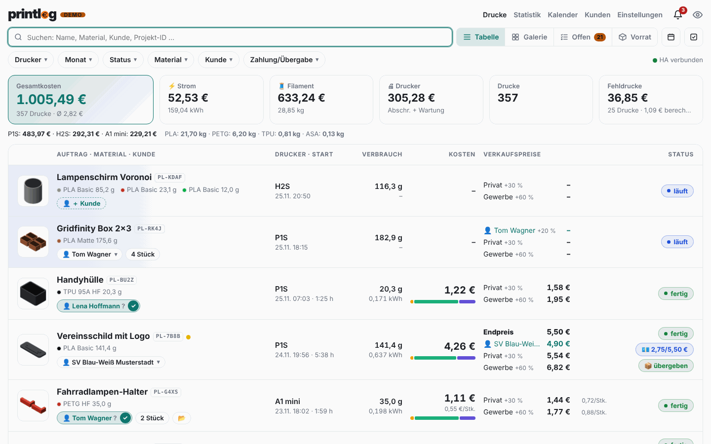</picture>

> **Zu diesem Projekt:** printlog ist auf mein eigenes Setup zugeschnitten (Bambu-Lab-Drucker, Home Assistant, ein paar
> Steckdosen mit Strommessung) und bleibt das auch. Du kannst es gern so nutzen, wie es ist. Wer es stark verändern
> möchte, legt am besten einen **Fork** an und macht ihn zu seinem eigenen; größere Feature-Pull-Requests werde ich
> voraussichtlich nicht übernehmen. Fehlermeldungen und kleine Korrekturen sind willkommen.

### Inhalt

[Funktionen](#funktionen) · [Bilder](#bilder) · [Ablauf](#ablauf) · [Voraussetzungen](#voraussetzungen) · [Installation](#installation-1) ·
[Konfiguration](#konfiguration) · [Aktualisieren](#aktualisieren) · [Ablauf pro Druck im Detail](#ablauf-pro-druck-im-detail) ·
[Oberfläche im Detail](#oberfläche-im-detail) · [Fehlersuche](#fehlersuche) · [API](#api-1)

### Funktionen

**Druck-Historie**

- **Automatisches Protokoll** jedes Drucks: Start, Ende, Dauer, Status (fertig / abgebrochen / unvollständig),
  Auftragsname, Drucker, Vorschaubild, Filament pro AMS-Fach mit Farbe und kWh.
- **Alles wiederfinden** – Live-Suche über Name, Material, Kunde, Notizen und Projektlinks; Filter nach Drucker, Monat,
  Status, Material, Kunde und Zahlung als schmale Chips (ein aktiver Filter zeigt seinen Wert und ein ✕ zum Entfernen);
  Tabelle oder Galerie, wahlweise nach Tagen gruppiert.
- **Offene Posten** – die Ansicht **Offen** neben Tabelle und Galerie zeigt alle Drucke, die noch nicht ganz bezahlt oder
  übergeben sind, nach Kunden gruppiert mit offenem Betrag und Stückzahl pro Kunde und Knöpfen, um Zahlung oder Übergabe
  direkt einzutragen. Kunden mit **Keine Abrechnung** und Fehldrucke, die nicht berechnet werden, fehlen; verschenkte Drucke stehen nur bis zur Übergabe darin.
- **Kunde mit zwei Tipps zuordnen** – ein Druck ohne Kunde zeigt direkt in der Liste einen Chip **👤 ＋ Kunde** (auch am
  Handy und auf der Druckseite). Antippen, Kunde wählen, fertig: kein Tab Bearbeiten, kein Speichern-Knopf, zehn Sekunden lang
  *Rückgängig*. Die Auswahl hat eine Suche, die drei zuletzt genutzten Kunden und einen Vorschlag: Hast du das gleiche Modell
  schon für jemanden gedruckt, steht im Chip gleich *Tom ? ✓*, und das ✓ allein ordnet zu. Für viele Drucke auf einmal gibt es
  *Auswählen → 👤 Kunde zuweisen* (z. B. mit dem Filter *Kunde: ohne Kunde*). **＋ Neuer Kunde** legt einen Kunden nur mit Namen an.
  Bei einem Projekt gilt der Kunde fürs ganze Projekt.
- **Eigene Angaben** – Fotos (direkt mit der Kamera, automatisch verkleinert), Notizen, Filament-Notizen (z. B. der
  genaue Farbname), MakerWorld-/Printables-Links mit Titel, ein lokaler Ordner und eine kurze Projekt-ID pro Druck (z. B. `PL-7K3Q`).
- **Fehldrucke** – abgebrochene Drucke zählen automatisch als Fehldruck, jeder Druck lässt sich auch selbst markieren,
  z. B. wenn er fertig ist, aber die Einstellungen nicht gepasst haben. Dazu eine Ursache (Einstellungen, Material, Haftung,
  Drucker-Defekt, Kundenwunsch geändert, Sonstiges) und die Wahl, was der Kunde zahlt: nichts, anteilig (in % oder als Betrag)
  oder voll. Ein berechneter Fehldruck steht dann wie jeder andere Druck unter **Offen**, auf dem Bon und im PDF. Notiz und
  Fotos dokumentieren, was passiert ist, der Nachdruck lässt sich verknüpfen. Die Statistik zeigt Fehldrucke nach Ursache,
  was berechnet wurde und was du selbst trägst.
- **Projekte** – Dinge aus vielen Teilen laufen oft auf mehreren Druckern gleichzeitig. Drucke auswählen
  (*Auswählen → 📦 Projekt bilden*), Name, Kunde und Zahl der fertigen Objekte angeben, und die Liste zeigt das Projekt als eine
  Zeile mit den summierten Kosten und einem ▾, das die einzelnen Drucke aufklappt. Das Projekt bekommt eine eigene ID, eine
  eigene Seite mit allen Drucken, einer Zeitleiste pro Drucker und Fotos und wird als Ganzes abgerechnet: Preis, Zahlungen,
  Übergaben, Bon und PDF laufen über das Projekt. Fehldrucke darin, die nicht berechnet werden, zählen nicht zum Preis. Die
  einzelnen Drucke behalten ihre Details und lassen sich wieder aus dem Projekt lösen; *Auflösen* macht alles wieder zu
  Einzeldrucken. Die Statistik zählt weiter die Drucke.
- **Stückzahl auf Kunden und Vorrat aufteilen** – 10 Clips gedruckt, 2 gehen an Tom, 4 an Anna und 4 bleiben im Regal?
  **✂ Aufteilen** auf der Druckseite verteilt die Stückzahl auf mehrere Kunden; was übrig bleibt, ist dein **Vorrat**. Die Liste
  behält eine Zeile mit Chips wie *Tom 2 · Anna 4 · 📦 Vorrat 4*, und jeder Kunde bekommt einen eigenen Anteil mit eigenem Preis
  (Kosten pro Stück + seine Marge oder ein Endpreis), eigenen Zahlungen, Übergaben und eigenem Bon. **Offen** zeigt so genau,
  was jeder noch zahlen oder abholen muss. Die Ansicht **Vorrat** neben *Offen* listet alles im Regal mit seinem Wert zu
  Selbstkosten; **Abgeben …** gibt später Stück an einen Kunden (der Preisvorschlag ist unter *Einstellungen → Margen*
  einstellbar) oder bucht sie ohne Kunde aus (selbst verwendet, kaputt, verloren). Projekte werden in **Sätzen** aufgeteilt
  (die Stückzahl des Projekts), und einzelne Teile eines Satzes lassen sich extra abgeben, z. B. nur ein Kopf eines Figuren-Bausatzes.
- **Papierkorb** mit Wiederherstellen; endgültig gelöscht wird erst nach einstellbaren Tagen.
- **Robust** – nach einem Neustart oder Verbindungsabbruch holt printlog verpasste Drucke aus dem Verlauf von Home Assistant nach (bis 7 Tage).

**Auswertung**

- **Statistik** nach Tag, Woche oder Monat: Druckstunden pro Drucker, Kostenanteile, Filament nach Material,
  Erfolgsquote, Tabelle pro Drucker und eine Jahres-Heatmap der Druckstunden.
- **Kalender** mit Drucken, Stunden, Kosten und Vorschaubildern pro Tag.
- **Daten & Backup** in den Einstellungen: Komplettsicherung als ein **ZIP** (Datenbank, Fotos, Logo, alle Einstellungen) zum
  Herunterladen und Wiedereinspielen, **CSV-Export** (Excel-tauglich), geplantes **Backup** in einen eingehängten Ordner und
  abgesichertes **Zurücksetzen**.

**Kosten und Kunden**

- **Echte Kosten pro Druck**
  - *Strom* aus dem kWh-Zähler einer Steckdose (Start bis Ende der Abkühlphase) oder geschätzt über eine feste Leistung, wenn keine Steckdose da ist.
  - *Filament* pro AMS-Fach (Gramm × €/kg), Preis nach Typ (PLA, PETG …) oder nach Sorte (z. B. „Bambu PLA Matte“).
  - *Drucker*: Abschreibung, Wartung pro Jahr und Verschleiß pro Stunde.
- **Verkaufspreise** – zwei benannte Margen, optional eine Marge pro Kunde und ein fester Endpreis pro Druck.
- **Kunden** – Teilzahlungen und Teilübergaben, Verschenktes, offene Beträge pro Kunde. Mit dem Häkchen **Keine Abrechnung**
  wird ein Kunde zum reinen Sammelplatz für Eigenbedarf (z. B. Modelle für eigene Uploads): Kosten und Statistik zählen
  weiter, aber es gibt nie Offenes, keine Badges „nicht bezahlt/nicht übergeben“, keinen Tab „Abrechnung“ und keinen Zahlungsstand auf Bon und PDF.
  Die Kundenliste bleibt kompakt: **Bearbeiten** klappt die Felder direkt in der Zeile auf, **+ Neuer Kunde** steht oben rechts.
- **Teilen** – ein PNG im Kassenbon-Stil für Kunden (WhatsApp usw.), eine interne Variante mit voller Kalkulation und
  eine A4-PDF-Kostenaufstellung, jeweils in der Sprache der Oberfläche.
- **Diskret-Modus** – ein Klick verwischt alle internen Werte, wenn ein Kunde mitschaut.
- **Demo-Modus** – *Einstellungen → Ansicht → Demo öffnen* zeigt die ganze App mit einem Jahr erfundener Drucke (drei
  Bambu-Drucker, Kunden mit Teilzahlungen und offenen Übergaben, Verschenktes, Fehldrucke, laufende Drucke, Fotos). Praktisch
  für Screenshots und zum Ausprobieren. Die Demo hat eine eigene Datenbank; deine echten Drucke, Home Assistant und das Backup bleiben unberührt.

### Bilder

| | |
|---|---|
| <a href="docs/screenshots/de/prints-filtered.png"><picture><source media="(prefers-color-scheme: dark)" srcset="docs/screenshots/de-dark/prints-filtered.png">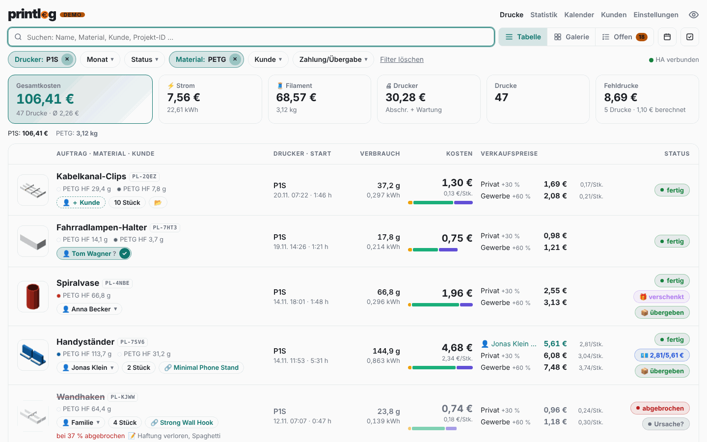</picture></a><br>**Suche und Filter-Chips** | <a href="docs/screenshots/de/gallery.png"><picture><source media="(prefers-color-scheme: dark)" srcset="docs/screenshots/de-dark/gallery.png">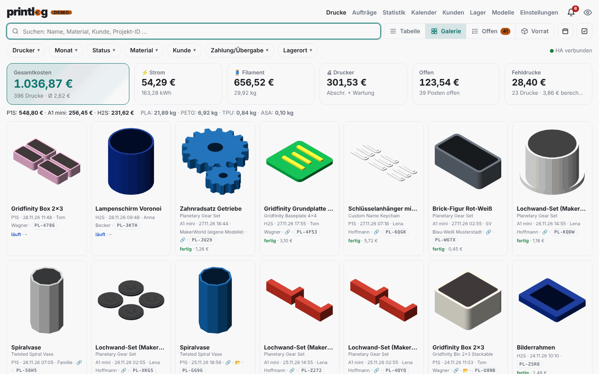</picture></a><br>**Galerie mit Vorschaubildern** |
| <a href="docs/screenshots/de/open-items.png"><picture><source media="(prefers-color-scheme: dark)" srcset="docs/screenshots/de-dark/open-items.png">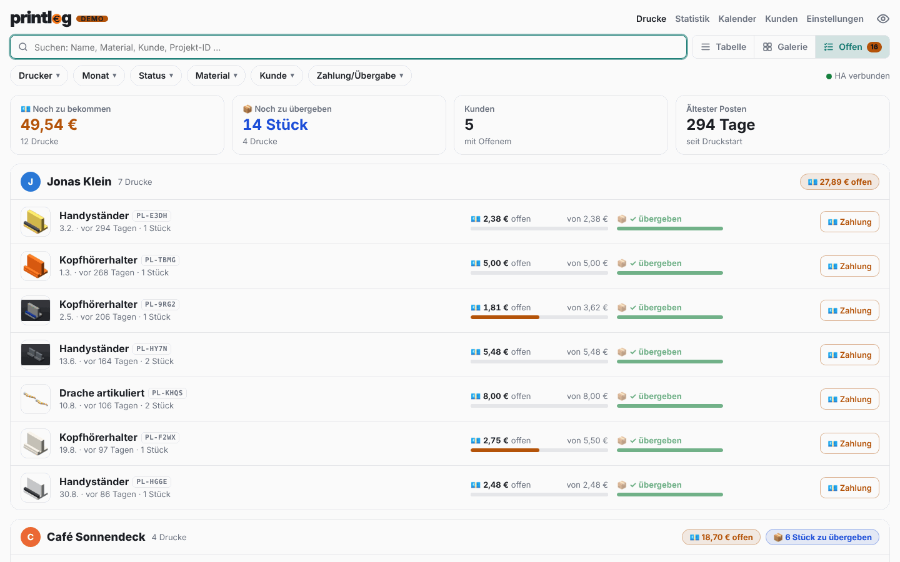</picture></a><br>**Offen: noch zu bezahlen oder zu übergeben** | <a href="docs/screenshots/de/print-detail.png"><picture><source media="(prefers-color-scheme: dark)" srcset="docs/screenshots/de-dark/print-detail.png">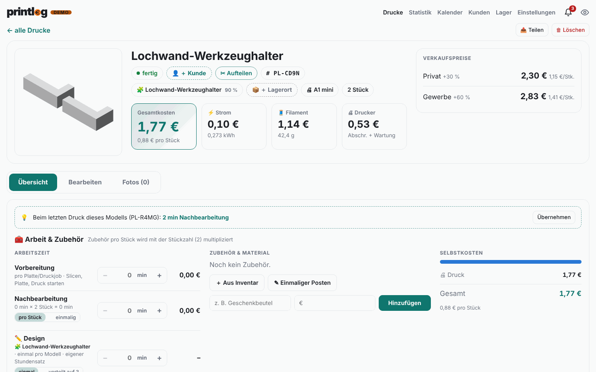</picture></a><br>**Druckdetails mit Kosten und Verkaufspreisen** |
| <a href="docs/screenshots/de/print-billing.png"><picture><source media="(prefers-color-scheme: dark)" srcset="docs/screenshots/de-dark/print-billing.png">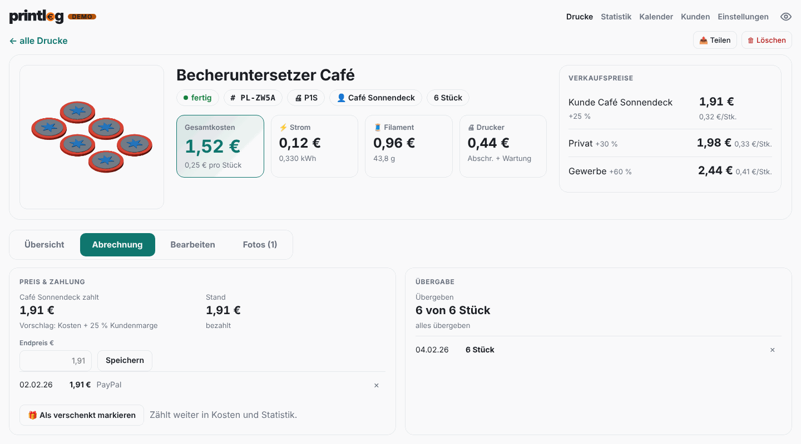</picture></a><br>**Abrechnung: Endpreis, Zahlungen, Übergaben** | <a href="docs/screenshots/de/statistics.png"><picture><source media="(prefers-color-scheme: dark)" srcset="docs/screenshots/de-dark/statistics.png">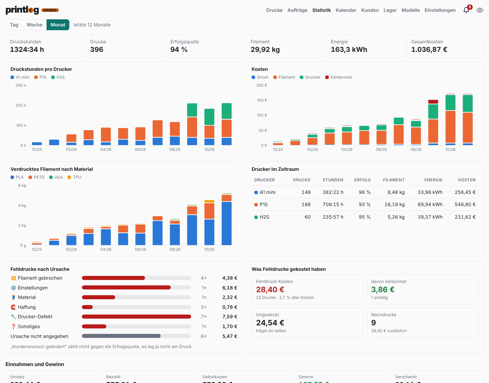</picture></a><br>**Statistik** |
| <a href="docs/screenshots/de/calendar.png"><picture><source media="(prefers-color-scheme: dark)" srcset="docs/screenshots/de-dark/calendar.png">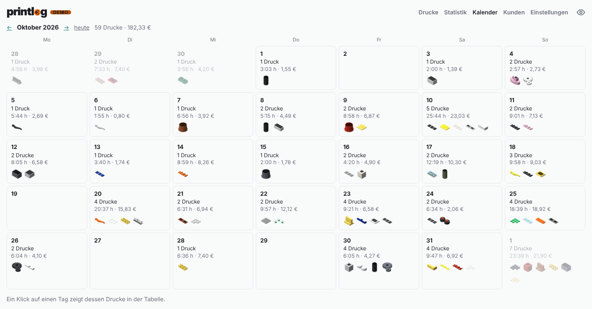</picture></a><br>**Kalender** | <a href="docs/screenshots/de/customers.png"><picture><source media="(prefers-color-scheme: dark)" srcset="docs/screenshots/de-dark/customers.png">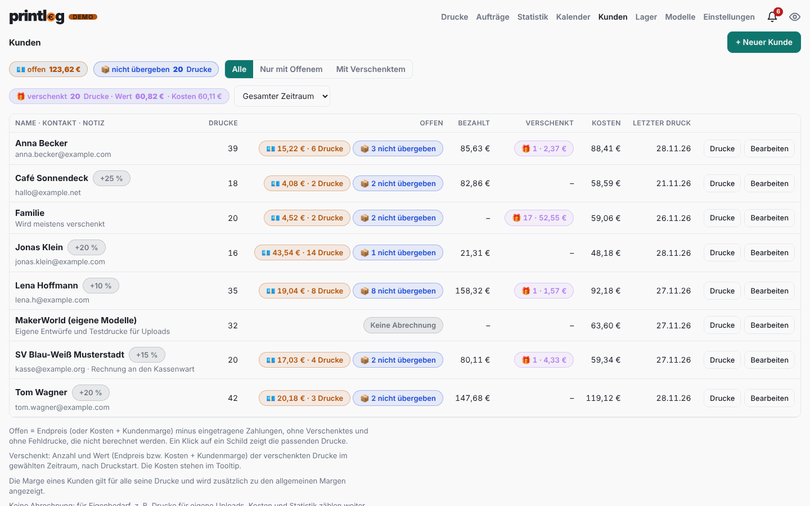</picture></a><br>**Kunden** |
| <a href="docs/screenshots/de/failed-print.png"><picture><source media="(prefers-color-scheme: dark)" srcset="docs/screenshots/de-dark/failed-print.png">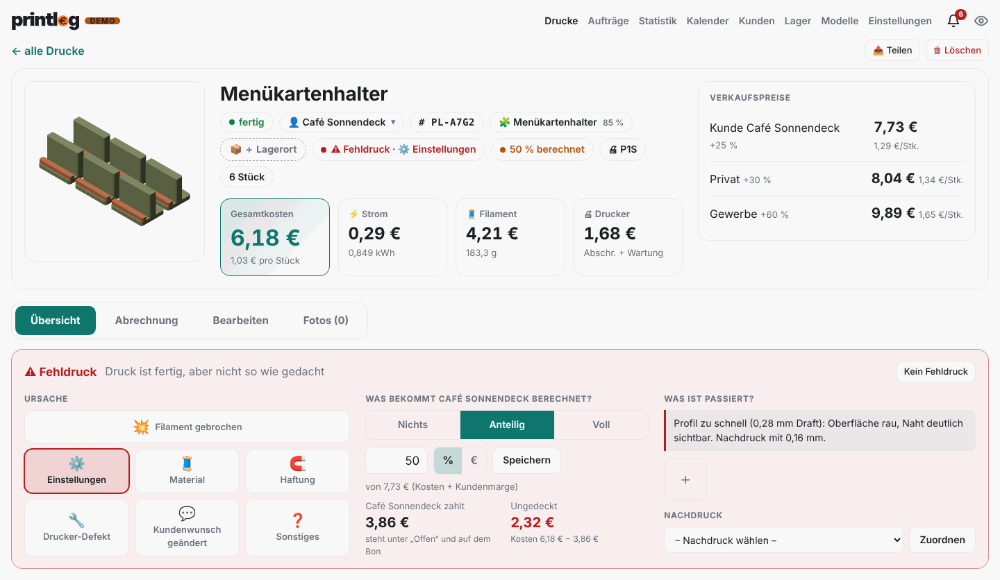</picture></a><br>**Fehldruck: Ursache, Berechnung und Nachdruck** | <a href="docs/screenshots/de/failed-print-stats.png"><picture><source media="(prefers-color-scheme: dark)" srcset="docs/screenshots/de-dark/failed-print-stats.png">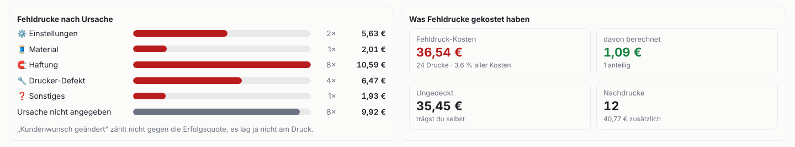</picture></a><br>**Fehldrucke nach Ursache und was sie kosten** |
| <a href="docs/screenshots/de/project-list.png"><picture><source media="(prefers-color-scheme: dark)" srcset="docs/screenshots/de-dark/project-list.png">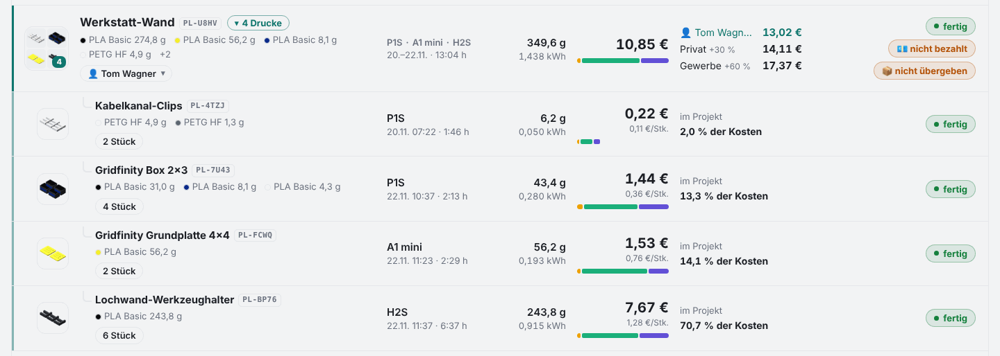</picture></a><br>**Projekt: eine Zeile, Drucke aufgeklappt** | <a href="docs/screenshots/de/project-detail.png"><picture><source media="(prefers-color-scheme: dark)" srcset="docs/screenshots/de-dark/project-detail.png">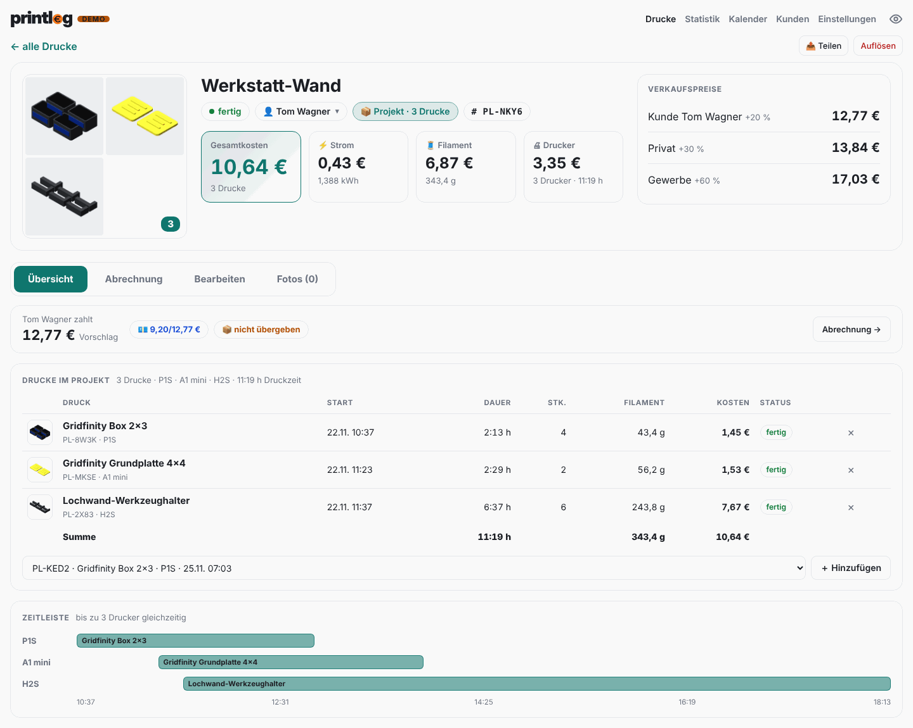</picture></a><br>**Projektseite mit Drucken und Zeitleiste** |
| <a href="docs/screenshots/de/assign-customer.png"><picture><source media="(prefers-color-scheme: dark)" srcset="docs/screenshots/de-dark/assign-customer.png">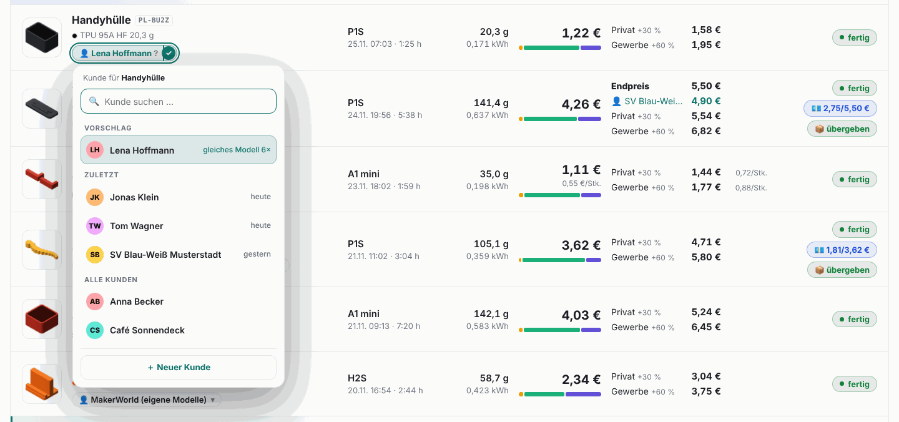</picture></a><br>**Kunde zuordnen: Chip in der Liste mit Vorschlag** | <a href="docs/screenshots/de/split-list.png"><picture><source media="(prefers-color-scheme: dark)" srcset="docs/screenshots/de-dark/split-list.png">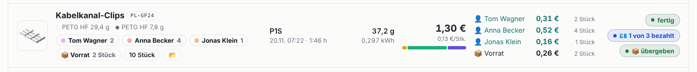</picture></a><br>**Aufgeteilter Druck: eine Zeile, ein Chip pro Kunde und Vorrat** |
| <a href="docs/screenshots/de/split-detail.png"><picture><source media="(prefers-color-scheme: dark)" srcset="docs/screenshots/de-dark/split-detail.png">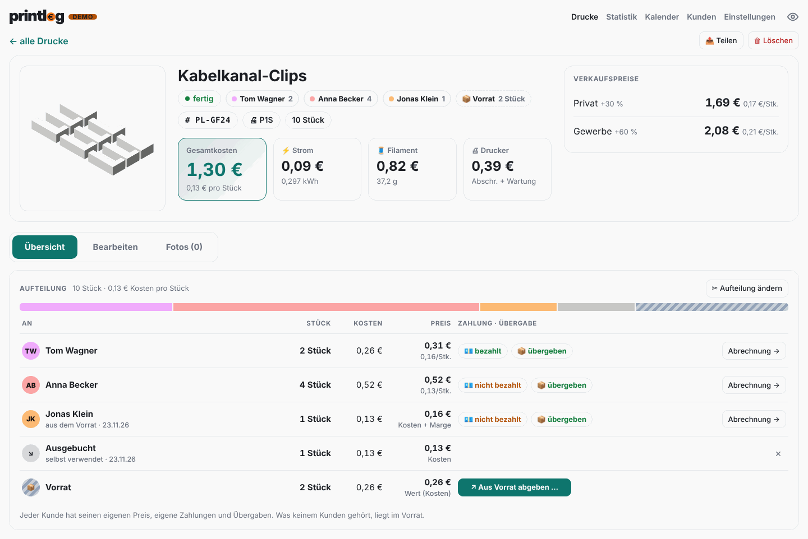</picture></a><br>**Aufteilung: jeder Kunde mit Preis, Zahlung und Übergabe, Rest im Vorrat** | <a href="docs/screenshots/de/split-dialog.png"><picture><source media="(prefers-color-scheme: dark)" srcset="docs/screenshots/de-dark/split-dialog.png">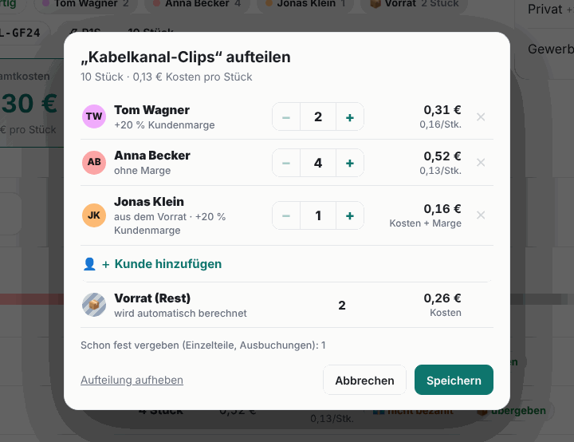</picture></a><br>**Fenster „Aufteilen“: Stück pro Kunde, der Vorrat rechnet sich aus** |
| <a href="docs/screenshots/de/stock.png"><picture><source media="(prefers-color-scheme: dark)" srcset="docs/screenshots/de-dark/stock.png">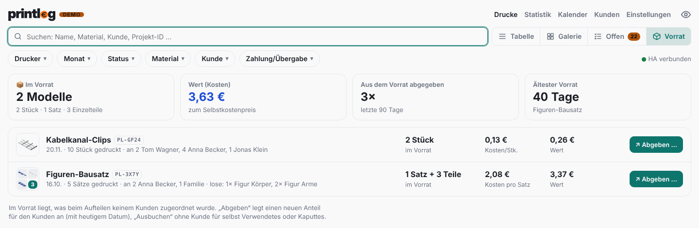</picture></a><br>**Vorrat: was im Regal liegt und was es wert ist** | |

| Handy: Drucke | Handy: Druckdetails | Handy: Offen | Handy: Vorrat |
|---|---|---|---|
| <a href="docs/screenshots/de/phone-list.png"><picture><source media="(prefers-color-scheme: dark)" srcset="docs/screenshots/de-dark/phone-list.png">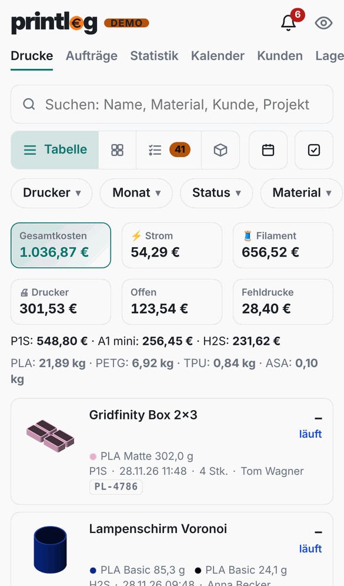</picture></a> | <a href="docs/screenshots/de/phone-detail.png"><picture><source media="(prefers-color-scheme: dark)" srcset="docs/screenshots/de-dark/phone-detail.png">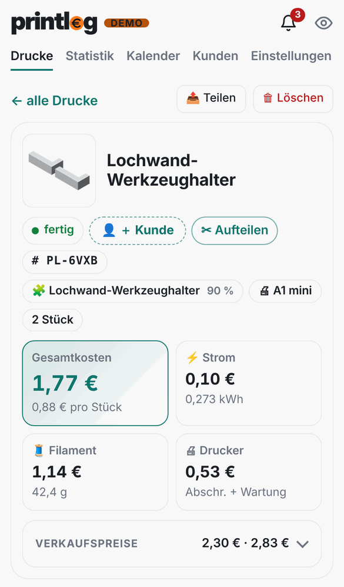</picture></a> | <a href="docs/screenshots/de/phone-open.png"><picture><source media="(prefers-color-scheme: dark)" srcset="docs/screenshots/de-dark/phone-open.png">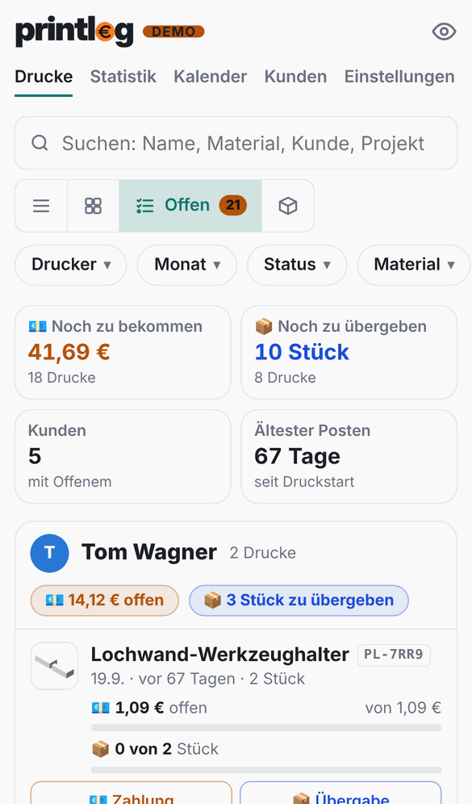</picture></a> | <a href="docs/screenshots/de/phone-stock.png"><picture><source media="(prefers-color-scheme: dark)" srcset="docs/screenshots/de-dark/phone-stock.png">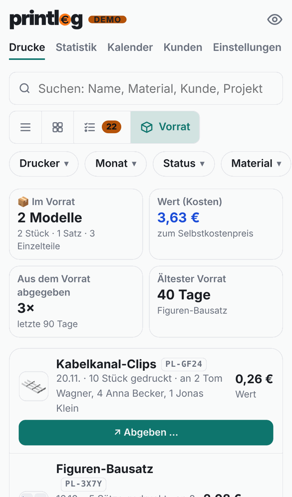</picture></a> |

| Bon für Kunden | Bon intern mit Kalkulation | PDF-Kostenaufstellung |
|---|---|---|
| <a href="docs/screenshots/de/receipt-customer.png">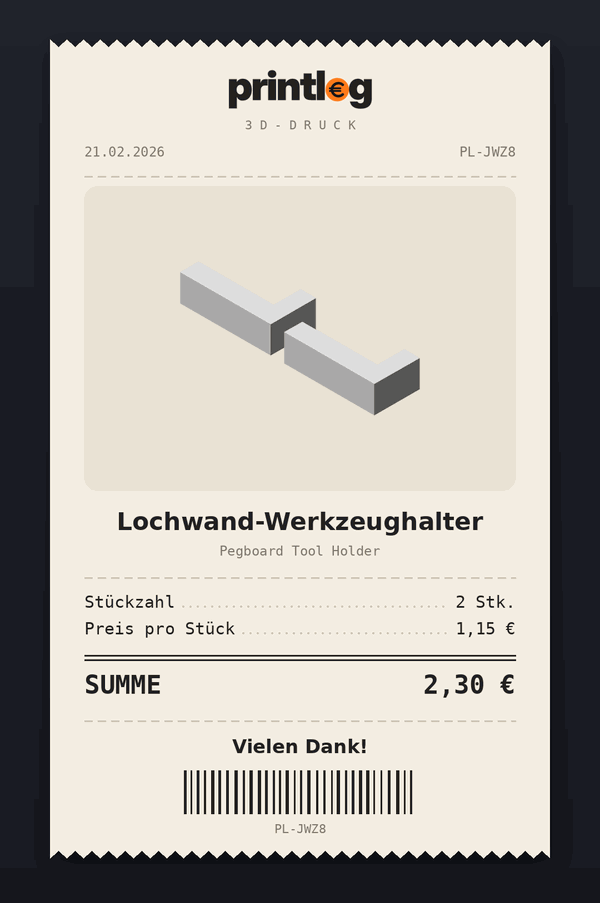</a> | <a href="docs/screenshots/de/receipt-internal.png">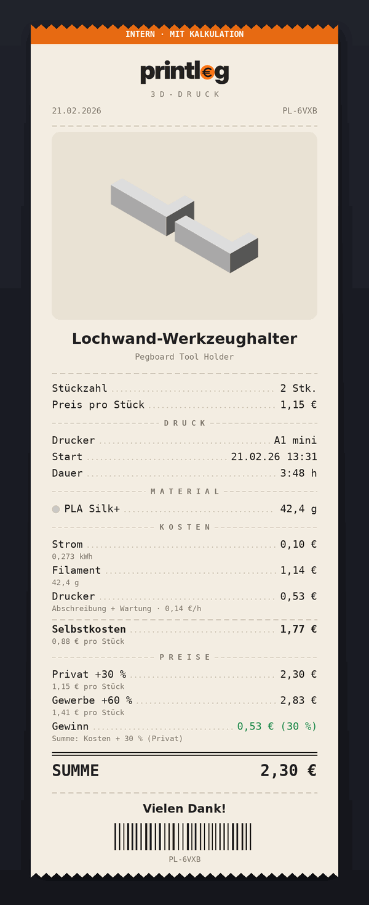</a> | <a href="docs/screenshots/de/cost-sheet.png">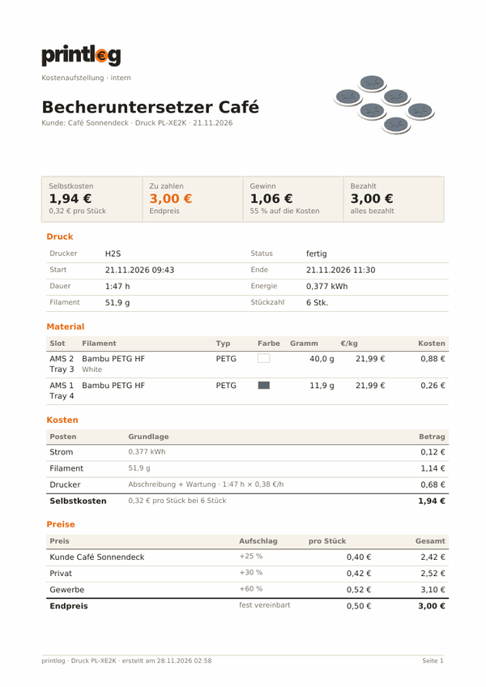</a> |

*Alle Bilder zeigen erfundene Beispieldaten aus dem eingebauten Demo-Modus (siehe [Funktionen](#funktionen)). Helle oder dunkle Bilder richten sich nach deinem GitHub-Design. Ein Klick vergrößert das Bild. Neu erstellen: [`docs/screenshots/capture.js`](docs/screenshots/capture.js).*

### Ablauf

1. Die **Bambu-Lab-Integration** in Home Assistant liefert Druckstatus, Auftragsname, Gewicht pro AMS-Fach und das Vorschaubild.
2. Eine **Automation pro Drucker** (aus dem mitgelieferten Blueprint) schickt ein Event `printlog` beim Druckstart,
   beim Druckende und nach der Abkühlphase noch einmal mit dem endgültigen Zählerstand.
3. Der **printlog-Container** hört über die WebSocket-API von Home Assistant zu, speichert jeden Druck und rechnet die Kosten aus.

Home Assistant bleibt schlank und schickt nur Events. Logik und Auswertung passieren im Container.

### Voraussetzungen

| Was | Hinweise |
|---|---|
| Home Assistant | Aktuelle Version (der Blueprint braucht 2024.10 oder neuer). |
| [Bambu-Lab-Integration](https://github.com/greghesp/ha-bambulab) | Über HACS. Liefert `…_print_status`, `…_print_weight`, `…_task_name`, die AMS-Fach-Sensoren und `image.…_cover_image`. |
| Steckdose pro Drucker *(optional)* | Braucht einen **Energie**-Sensor (kWh, Gesamtzähler) und am besten einen **Leistungs**-Sensor (W). Shelly, Tasmota, Zigbee usw. Ohne Steckdose trägst du in printlog eine feste Leistung pro Drucker ein. |
| Strompreis | Eine Entität mit €/kWh, z. B. ein Zahlenwert-Helfer `input_number.strompreis`. |
| Docker | Docker Compose oder Portainer auf einem Rechner, der Home Assistant erreicht. |

### Installation

#### 1. Home Assistant vorbereiten

1. Die **Bambu-Lab**-Integration über HACS installieren und die Drucker hinzufügen.
2. *(Optional)* Pro Drucker eine Steckdose mit Strommessung einbinden.
3. Strompreis-Helfer anlegen: *Einstellungen → Geräte & Dienste → Helfer → Helfer erstellen → Zahlenwert*,
   Name z. B. „Strompreis“ (Entität `input_number.strompreis`), Einheit €/kWh, Schrittweite 0,001, Preis eintragen.
4. Ein **langlebiges Zugriffstoken** erstellen: Benutzerprofil → *Sicherheit* → *Langlebige Zugriffstokens* → *Token erstellen*,
   Name `printlog`, Token kopieren.

#### 2. Container starten

**Docker Compose**

```bash
git clone https://github.com/relax81/printlog.git
cd printlog
cp .env.example .env      # HA_URL und HA_TOKEN eintragen
docker compose up -d --build
```

Dann `http://<docker-host>:8095` öffnen. `http://<docker-host>:8095/health` liefert `200`, sobald printlog mit Home Assistant verbunden ist.

**Portainer (Git-Stack)**

*Stacks → Add stack → Repository*: Adresse dieses Repos, Branch `main`, Compose-Pfad `docker-compose.yml`.
Unter *Environment variables* mindestens `HA_URL` und `HA_TOKEN` eintragen und deployen. Updates später mit
*Pull and redeploy* (oder GitOps-Polling einschalten).

#### 3. Blueprint installieren

Den Blueprint gibt es in zwei Sprachen mit gleicher Funktion:

- Deutsch: [`blueprints/automation/printlog/printlog_drucker.yaml`](blueprints/automation/printlog/printlog_drucker.yaml)
- Englisch: [`blueprints/automation/printlog/printlog_printer.yaml`](blueprints/automation/printlog/printlog_printer.yaml)

Unter *Einstellungen → Automationen & Szenen → Blueprints → Blueprint importieren* mit der GitHub-Adresse der Datei
importieren, oder die Datei nach `/config/blueprints/automation/printlog/` kopieren und die Automationen neu laden.

#### 4. Eine Automation pro Drucker anlegen

*Einstellungen → Automationen & Szenen → Blueprints → „printlog: Druck erfassen (Bambu Lab)“ → Automation erstellen*:

| Eingabe | Was auswählen |
|---|---|
| **Kurzname** | Kurz und eindeutig, Kleinbuchstaben, z. B. `x1c`. Darunter speichert printlog die Drucke, also später nicht ändern. |
| **Druckstatus** | `sensor.…_print_status` des Druckers. Die übrigen Entitäten findet die Automation über denselben Namensanfang. |
| **AMS-Einheiten** | Pro AMS der Sensor von Fach 1 (`sensor.…_tray_1`), in der Reihenfolge AMS 1, AMS 2 … Ohne AMS leer lassen. |
| **Externe Spule** | `sensor.…_external_spool` *(optional)* |
| **Energiezähler** | kWh-Sensor der Steckdose *(optional)* |
| **Leistung** | W-Sensor der Steckdose *(optional, erkennt das Ende der Abkühlphase)* |
| **Strompreis** | z. B. `input_number.strompreis` *(optional, sonst fragt printlog `PRICE_ENTITY` selbst ab)* |
| *Feinheiten* | Standby-Leistung (30 W), Abkühlphase höchstens (5 min), Nachlauf für den Zähler (70 s). Die Standardwerte passen zu Shelly. |

Für jeden Drucker wiederholen. Beim nächsten Druck erscheint er nach spätestens einer Minute in printlog, das Vorschaubild kurz danach.
Wichtig beim Umstieg von einer alten Sammel-Automation: für bestehende Drucker denselben Kurznamen nehmen und die alte
Automation erst danach ausschalten, sonst kommen Events doppelt.

#### 5. Einrichtung in printlog abschließen

Unter **Einstellungen**:

- **Drucker** – füllt printlog mit dem ersten Event jeder Automation selbst aus. ✓ zeigt den aktuellen Wert aus Home Assistant,
  ⚠ eine Entität, die es nicht gibt. Für Drucker ohne Steckdose **Feste Leistung (W)** eintragen. Drucker lassen sich auch von Hand anlegen.
- **Kosten** – Anschaffungspreis, erwartete Lebensdauer in Druckstunden, Wartung pro Jahr und Verschleiß pro Stunde je Drucker.
- **Filament** – €/kg pro Filamenttyp, optional pro Sorte.
- **Margen** – bis zu zwei benannte Margen (z. B. Privat / Gewerbe).
- **Bon & PDF** – eigenes Logo für Bon-Bild und PDF.
- **Ansicht** – Sprache, Farbschema (automatisch / hell / dunkel), Start-Tab der Detailseite, Aufbewahrung im Papierkorb.
- **Daten & Backup** – ZIP-Sicherung und Einspielen, CSV-Export, Backup-Zeitplan (braucht `BACKUP_DIR`, siehe unten), Zurücksetzen.

#### 6. Optional

- **Reverse Proxy** (Nginx Proxy Manager, Traefik, Caddy …): einen Hostnamen auf `<docker-host>:8095` zeigen lassen, WebSocket-Unterstützung an.
- **Home-Assistant-Dashboard**: printlog mit einer *Webseite*-Karte (`type: iframe`) einbetten; läuft HA über HTTPS, auch printlog über HTTPS aufrufen.
- **Ordner-Links unter Windows**: Pro Druck lässt sich ein lokaler Ordner oder eine Datei hinterlegen. Unter *Einstellungen → Windows*
  gibt es eine Einrichtung per Doppelklick (`printlog-einrichten.cmd`), die den Link-Typ `printlog-open:` für den eigenen Benutzer einträgt.
  Ordner öffnen sich im Explorer. 3D-Dateien (3MF, STL, STEP, OBJ) öffnen sich im Standardprogramm, aber nur innerhalb des
  Projektordners, den man bei der Einrichtung am PC wählt; alles andere wird nur im Explorer markiert. Programme oder Skripte startet ein Link nie.

### Konfiguration

Umgebungsvariablen (in `.env` oder im Portainer-Stack); alles andere stellst du in der Oberfläche ein.

| Variable | Standard | Zweck |
|---|---|---|
| `HA_URL` | `http://homeassistant.local:8123` | Adresse von Home Assistant, wie der Container sie erreicht. |
| `HA_TOKEN` | – (Pflicht) | Langlebiges Zugriffstoken. |
| `PRICE_ENTITY` | `input_number.strompreis` | Preis pro kWh, falls ein Event keinen Preis mitbringt. |
| `TZ` | `Europe/Berlin` | Zeitzone für Datum, Statistik und Backup. |
| `PRINTLOG_PORT` | `8095` | Port auf dem Docker-Host. |
| `BACKUP_DIR` | leer (aus) | Backup-Ziel im Container, z. B. `/backup` (dort in `docker-compose.yml` einen Ordner einhängen). |
| `BACKUP_HOUR` | `3` | Standard-Uhrzeit für den Backup-Zeitplan. |
| `IMPORT_MAX_MB` | `4096` | Größtes ZIP, das sich einspielen lässt. Ein Reverse Proxy braucht evtl. auch ein höheres Upload-Limit. |
| `SAFETY_KEEP` | `5` | So viele automatische Sicherungen vor Einspielen/Zurücksetzen bleiben. |
| `IMAGE_DELAY_S` | `60` | Sekunden bis zum Abruf des Vorschaubilds nach dem Start. |
| `ENERGY_ENTITY` | leer | Nur für Updates von sehr alten Ständen: Muster der Energie-Entität mit Platzhalter `{printer}`. |
| `LOG_LEVEL` | `INFO` | Log-Level. |

**Sprache:** *Einstellungen → Ansicht → Sprache* wechselt zwischen *Automatisch* (Sprache des Browsers, Englisch, wenn
weder Deutsch noch Englisch bevorzugt ist), *Deutsch* und *English*. Das gilt für Oberfläche, Bon-Bilder, PDF und
CSV-Export (deutsches CSV mit Semikolon und Dezimalkomma, englisches mit Komma und Dezimalpunkt). Installationen, die es
schon vor der Sprachwahl gab, bleiben deutsch, bis du es änderst.

**Daten** liegen im Docker-Volume `printlog-data`: `printlog.db` (SQLite) und `images/` (Vorschaubilder, Fotos, Logo).
Der Demo-Modus hat seine eigene Kopie in `demo/` (rund 30 MB, kann jederzeit gelöscht werden).
**Backup** mit gesetztem `BACKUP_DIR`: pro Lauf eine Datenbank-Kopie in `db/printlog-JJJJ-MM-TT.db` (die letzten 14 bleiben)
und ein Spiegel aller Bilder in `images/`. Täglich oder wöchentlich (Standard: sonntags 3 Uhr), Änderungen greifen ohne Neustart;
„Jetzt sichern“ steht in den Einstellungen.

**Komplettsicherung als ZIP** (*Einstellungen → Daten & Backup*): *ZIP herunterladen* packt `printlog.db` (Drucke, Kunden,
Zahlungen, Papierkorb und alle Einstellungen inkl. Drucker-Zuordnung und Preise), `images/` (Vorschaubilder, Fotos,
Bon-Logo), `manifest.json` und eine lesbare `einstellungen.json`. *Sicherung einspielen* nimmt so ein ZIP zurück. printlog
akzeptiert nur die genannten Dateien (keine Pfade außerhalb des Datenordners, keine Links, Größenlimits, gültige
printlog-Datenbank ohne Trigger), zeigt eine Vorschau (jetzt vs. nach dem Einspielen) und ersetzt erst nach deiner
Bestätigung. Vor jedem Einspielen oder Zurücksetzen sichert printlog den bisherigen Stand automatisch als ZIP in
`sicherungen/` im Daten-Volume; die letzten stehen im selben Tab zum Herunterladen oder Einspielen. Die Sprache bleibt.

**Demo-Modus** (*Einstellungen → Ansicht → Demo öffnen* oder direkt `/demo/`): dieselbe Oberfläche mit erfundenen
Beispieldaten, z. B. für Screenshots, ohne eigene Drucke zu zeigen, oder zum Ausprobieren ohne Drucker. Ein Hinweisbalken
und ein Schild „Demo“ am Logo zeigen, wo du bist; den Balken kannst du für Screenshots ausblenden (das Schild bleibt).
In der Demo darfst du alles ändern: Sie nutzt eine eigene Datenbank und eigene Bilder in `demo/`, bekommt keine Events
von Home Assistant, fragt dort nichts ab und schreibt nie ins Backup-Ziel. Die Beispieldaten reichen ein Jahr bis heute
zurück und werden nach 12 Stunden, nach einem Neustart, beim Sprachwechsel in der Demo oder mit *Neu erzeugen* im Balken
frisch angelegt. Alle Namen und Kontakte sind erfunden (Adressen mit `example.com`).

**Zurücksetzen** (*Einstellungen → Daten & Backup → Zurücksetzen …*): *Nur Drucke und Verlauf* (Drucke, Fotos, Zahlungen,
Übergaben, Papierkorb; Kunden und Einstellungen bleiben) oder *Alles* (wie eine frische Installation, nur die Sprache
bleibt) wählen und den angezeigten Code eintippen. Vorher entsteht automatisch eine Sicherung.

### Aktualisieren

Neue Version holen und neu bauen: `git pull && docker compose up -d --build` (Portainer: *Pull and redeploy*).
Die Datenbank wird beim Start automatisch angepasst. Hat sich der Blueprint geändert, ihn neu importieren (oder die Datei
erneut kopieren) und die Automationen neu laden; bestehende Automationen behalten ihre Eingaben.

### Ablauf pro Druck im Detail

| Event-Phase | Wann | Was passiert |
|---|---|---|
| `start` | Status wechselt auf `running` (auch nach Pause, nicht aus Offline) | Zeile anlegen, Zählerstand merken, Vorschaubild holen |
| `stop`  | Status wechselt von `running`/`pause`/`prepare` auf `finish`/`failed` | Status fertig/abgebrochen, Zählerstand und Fortschritt merken |
| `final` | Leistung unter Standby (Abkühlen vorbei, max. 5 min) + 70 s | kWh = Ende − Start, Kosten = kWh × Strompreis |

Sonderfälle:

- Container aus (Redeploy, Neustart) oder Verbindung zu HA weg: Nach jedem Verbinden liest printlog den Verlauf der
  Druckstatus- und Zähler-Sensoren (seit der letzten Verbindung, max. 7 Tage) und holt verpasste `start`/`stop` nach denselben
  Regeln wie die Automation nach. Bereits erfasste Events werden nicht doppelt angelegt, Drucke aus dem Papierkorb nicht neu.
- Kein `final` innerhalb von 20 min: Abschluss mit dem Zählerstand vom `stop`.
- Pausen (Magnete einsetzen, Platte prüfen, kurzer Fehler beim Vorbereiten, egal wie lange): Beim Weiterdrucken schickt der
  Blueprint wieder `start`. printlog erkennt an der Startzeit des Druckers (`printer_start_time`), dass es derselbe Druck
  ist, und legt keine neue Zeile an. Fehlte der erste Start, wird er so nachgeholt.
- Neuer Start ohne Ende davor (andere Startzeit): die alte Zeile wird „unvollständig“.
- Ende ohne Start: printlog legt die Zeile beim Ende an und holt den Zählerstand zur Startzeit des Druckers aus dem
  HA-Verlauf („Startwert aus HA-Verlauf ergänzt“). Nur wenn auch das nicht geht, bleibt sie „unvollständig“ ohne kWh.
  Solche Zeilen der letzten 7 Tage repariert printlog beim nächsten Verbinden mit HA automatisch.
- Steckdose offline oder Zähler zurückgesetzt: keine kWh, Hinweis in der Zeile; mit fester Leistung wird geschätzt.
- Fehldrucke bekommen eine eigene Zeile „abgebrochen“, Filament nur anteilig bis zum Abbruch.

### Oberfläche im Detail

- **Drucke**: große Live-Suche (Teilwörter, mehrere Wörter, Umlaute egal), darunter die Filter als Chips; Ansichten Tabelle,
  Galerie, Offen (mit Zähler) und Vorrat. Die Icons rechts gruppieren „Nach Tagen“ und starten „Auswählen“ (Mehrfachauswahl, Löschen mit „Rückgängig“).
  Ein Farbbalken zeigt die Kostenanteile, Antippen öffnet die Aufschlüsselung.
- **Druckdetails**: Tabs Übersicht, Abrechnung (nur mit Kunde, nicht bei „Keine Abrechnung“), Bearbeiten und Fotos. Der Start-Tab ist einstellbar.
- **Endpreis, Zahlung, Übergabe** (nur mit Kunde, nicht bei Fehldrucken ohne Berechnung): optionaler Endpreis, sonst Kosten + Kundenmarge.
  Zahlungen und Übergaben sind einzelne Einträge, damit Teilzahlungen und Teilabholungen gehen. Badges in der Liste öffnen ein
  Menü (z. B. „Alles bezahlt“).
- **Fehldruck**: Kasten oben in der Übersicht mit Ursache als Kacheln, Umschalter Nichts / Anteilig / Voll (anteilig in %
  oder €), Notiz, Fotos und Nachdruck. „Kundenwunsch geändert“ zählt nicht gegen die Erfolgsquote. In der Liste filtert
  „Status“ nach Fehldrucken und nach Ursache.
- **Projekt**: in der Mehrfachauswahl „📦 Projekt bilden“ (neues Projekt oder zu einem bestehenden hinzufügen; ausgewählte
  Projekte werden zusammengelegt). Ein Projekt hat genau einen Kunden, der für alle seine Drucke gilt. Kosten sind die Summe
  der Drucke; der Preisvorschlag lässt unberechnete Fehldrucke weg, anteilig berechnete zählen anteilig. Zahlungen der Drucke
  wandern beim Zusammenfassen ins Projekt, beim Auflösen an den ersten Druck. Ein Nachdruck zu einem Fehldruck im Projekt
  kommt automatisch mit hinein. Die Druckseite zeigt den Anteil am Projekt, Kunde und Abrechnung ändert man am Projekt.
  Statistik, Kalender und Kundenzählung zählen nur die Drucke, nie das Projekt; die CSV hat eine Spalte „Gehört zu Projekt“.
- **Aufteilen & Vorrat**: „✂ Aufteilen“ im Kopf eines Drucks mit mehr als einem Stück (bei Projekten immer). Im Fenster pro Kunde
  die Stückzahl (−/+), „＋ Kunde hinzufügen“ nutzt die Schnellauswahl, der Vorrat rechnet sich live aus. Jeder Anteil ist ein
  eigener Eintrag mit anteiligen Kosten, eigener Projekt-ID, Preis, Zahlungen, Übergaben und Bon; „Abrechnung →“ öffnet ihn.
  Beim ersten Aufteilen bekommt der Anteil des bisherigen Kunden dessen Zahlungen, Übergaben und Endpreis (anteilig).
  „Aufteilung aufheben“ macht alles rückgängig. Ausbuchungen ohne Kunde lassen sich mit × zurück in den Vorrat legen.
  Bei Projekten zählt ein Satz alle Drucke einmal (Stück des Drucks ÷ Sätze); wird ein Einzelteil abgegeben, zeigt der Vorrat
  die ganzen Sätze und die losen Teile. Statistik und Kalender zählen weiter den Druck; die CSV hat eine Spalte „Aufteilung“.
- **Verschenkt**: zählt weiter in Kosten und Statistik, braucht aber keine Zahlung; unter „Kunden“ mit Anzahl und Wert pro Zeitraum.
- **Keine Abrechnung** (Häkchen beim Kunden): gilt für alle Drucke dieses Kunden, nicht pro Druck. Anders als „Verschenkt“
  taucht nichts unter „Verschenkt“ auf; der Kunde steht unter „Kunden“ mit dem Schild „Keine Abrechnung“ statt offener Beträge.
- **Teilen** („📤 Teilen“): Bild für Kunden, Bild intern, PDF. Am Handy über das Teilen-Menü des Systems, am PC als Download.
  Das Häkchen „Bezahlt/Übergeben mit drauf“ lässt den Zahlungsstand weg. Im Diskret-Modus nur das Kundenbild.
- **Projekt-ID** wie `PL-7K3Q` auf Liste, Detailseite, Bon, PDF und im Dateinamen; Enter auf einer ID in der Suche öffnet den Druck.
- **Diskret-Modus** (Auge oben rechts): verwischt Kosten, Margen und Statistik; Endpreis bzw. Kundenpreis und Zahlungsstatus bleiben sichtbar.
- **Eigene Fotos** werden gedreht (EXIF) und auf höchstens 2560 px verkleinert.
- **Layout**: Seiten höchstens 1440 px breit, Formulare (Einstellungen, Bearbeiten, Papierkorb) 960 px. Eingabefelder sind
  überall gleich hoch, am PC 38 px, auf Handy und Tablet 44 px mit 16 px Schrift (iOS zoomt dann nicht ins Feld).
  Am Handy wandert die Navigation in eine eigene, wischbare Zeile; der Kalender zeigt dort nur die Anzahl der Drucke pro Tag.

### Fehlersuche

- **`/health` liefert 503** – keine Verbindung. `HA_URL` (vom Container erreichbar?) und `HA_TOKEN` prüfen, `docker logs printlog` ansehen.
- **Drucke erscheinen nicht** – Ablaufverfolgung der Automation in Home Assistant prüfen und ob der Kurzname gesetzt ist.
- **Keine kWh / „Zählerstand fehlte“** – Steckdose war offline oder der Energie-Sensor stimmt nicht; *Einstellungen → Drucker* prüfen, als Ersatz eine feste Leistung eintragen.
- **Drucke doppelt** – zwei Automationen melden denselben Drucker. Pro Drucker nur eine behalten.
- **Kein Vorschaubild** – die Integration lädt es erst kurz nach dem Start; printlog holt es am Druckende noch einmal.

### API

Wie im [englischen Teil](#api). Die Export-Adressen heißen unabhängig von der Sprache `export/<id>/bon-kunde.png`,
`bon-intern.png` und `kosten.pdf`.

printlog hat selbst keine Anmeldung. Nur im Heimnetz betreiben oder hinter einen Reverse Proxy mit Zugangsschutz stellen.
